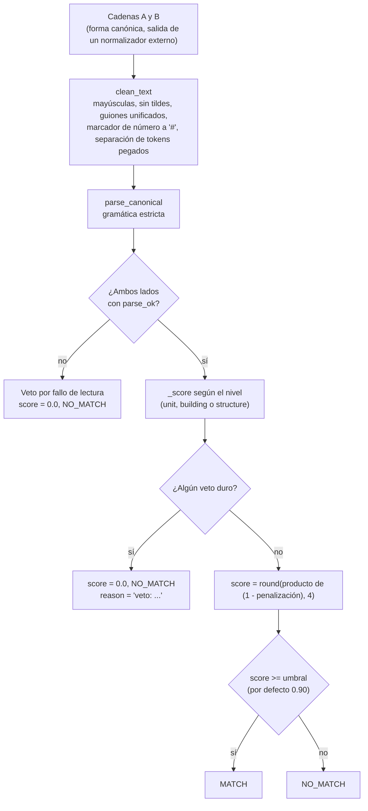
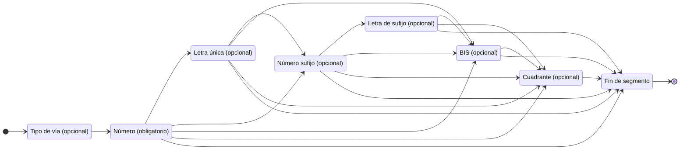
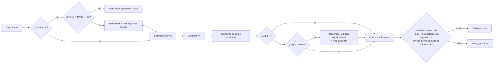
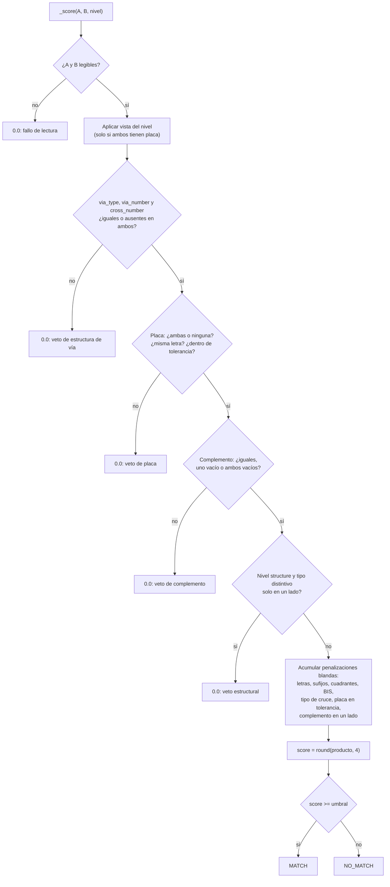
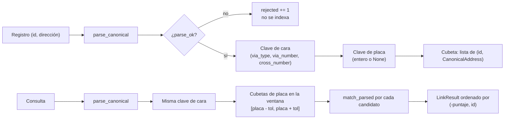

# 01 - Teoría del método

Este documento explica el problema que resuelve el modelo, la gramática que interpreta, la fórmula del puntaje, los vetos, los niveles de comparación y el índice con bloqueo. Todo se verificó contra `src/emparejador/parser.py`, `matcher.py` e `index.py`.

## Contenido

1. [Aviso: este modelo no es una red neuronal](#1-aviso-este-modelo-no-es-una-red-neuronal)
2. [El problema](#2-el-problema)
3. [Teoría del análisis sintáctico](#3-teoría-del-análisis-sintáctico)
4. [Puntaje por producto de penalizaciones](#4-puntaje-por-producto-de-penalizaciones)
5. [Vetos duros](#5-vetos-duros)
6. [Niveles unit, building y structure](#6-niveles-unit-building-y-structure)
7. [Bloqueo del índice y por qué no pierde candidatos](#7-bloqueo-del-índice-y-por-qué-no-pierde-candidatos)
8. [Umbral 0,90 y el intervalo vacío de puntajes](#8-umbral-090-y-el-intervalo-vacío-de-puntajes)
9. [Por qué el puntaje no es una probabilidad](#9-por-qué-el-puntaje-no-es-una-probabilidad)

Documentos relacionados: [02 arquitectura](02-arquitectura.md), [06 predicciones](06-predicciones.md), [08 métricas](08-metricas-y-confiabilidad.md), [10 estándar](10-estandar-y-generalizacion.md).

## 1. Aviso: este modelo no es una red neuronal

Este modelo no contiene una red neuronal; los diagramas siguientes describen el algoritmo:

| Componente | Qué es realmente |
|---|---|
| Lectura de la dirección | Analizador sintáctico escrito a mano (tokenizador y gramática de izquierda a derecha), con expresiones regulares y tablas de alias |
| Puntaje | Producto de factores de supervivencia con constantes fijas (`_PENALTIES` en `matcher.py:132`) y vetos duros |
| Vinculación contra una base | Diccionario en memoria que agrupa registros por (tipo de vía, número de vía, número de cruce) y luego por placa |
| Parámetros aprendidos | Ninguno. No hay pesos, ni archivo serializado, ni semilla aleatoria en ejecución |

Por qué esto es una fortaleza:

- **Auditabilidad:** cada decisión se explica campo por campo (`MatchResult.fields`, `reason`).
- **Determinismo:** la misma entrada produce siempre la misma salida; el orden de los candidatos también es determinista.
- **Cero pesos:** nada que entrenar, versionar ni proteger; no se requiere GPU.
- **Fallar de forma conservadora:** lo que la gramática no entiende se rechaza (veto), no se adivina.

Por qué es también una limitación:

- No generaliza: una escritura que la gramática o las tablas de alias no conocen produce fallo de lectura, no una estimación aproximada.
- No aprende de los datos: mejorar la cobertura exige editar tablas y código.
- Las constantes de penalización fueron elegidas por diseño, no ajustadas con un criterio estadístico; el puntaje no está calibrado (sección 9).

Los diagramas que sí aplican (flujo, gramática, árbol de puntaje, índice, secuencia) están en esta página y en [02](02-arquitectura.md).

## 2. El problema

En un contexto catastral, el mismo predio aparece escrito de muchas formas en fuentes distintas (registros administrativos, reportes de campo, bases comerciales). Vincularlos por dirección exige decidir si dos cadenas nombran **la misma puerta**. Los errores tienen costos asimétricos: un falso vínculo (dos predios distintos unidos) suele ser peor que una omisión, y el diseño lo refleja ("a false MATCH is worse than a miss", comentario de diseño en `parser.py`).

El modelo resuelve solo la comparación entre direcciones **ya normalizadas**. No convierte texto libre en forma canónica (esa es la tarea del normalizador previo; ver [06](06-predicciones.md)).

### Flujo de extremo a extremo



## 3. Teoría del análisis sintáctico

### Gramática canónica

```text
SEGMENT := [TYPE] NUMBER [LETTER] [SUFFIX_NUMBER [SUFFIX_LETTER]] [BIS] [QUADRANT]
ADDRESS := SEGMENT_VIA "#" [SEGMENT_CROSS] ["-" [PLATE]] [COMPLEMENT...]
```

- `SEGMENT_VIA` es la vía principal; `SEGMENT_CROSS`, la vía generadora (calle transversal).
- `PLATE` es la placa (número de puerta), con una letra final opcional.
- `COMPLEMENT` es la cola posterior a la placa (apartamento, torre, local, etc.).

Esta gramática usa `#` entre vía y cruce, y `-` antes de la placa. Su relación con el estándar nacional se analiza en [10](10-estandar-y-generalizacion.md).

### Dos capas

1. **`clean_text`** (`parser.py:311`): higiene superficial. Normaliza Unicode (NFKD), elimina marcas combinantes y caracteres de formato invisibles, pasa a mayúsculas, unifica variantes de guion, convierte `Nº`, `No.`, `NRO`, `NUM` y (en posición específica) `NUMERO` a `#`, quita puntos finales de token, separa tokens pegados (`98F` a `98 F`, `CL12` a `CL 12`, `4ABIS` a `4 A BIS`) y colapsa separadores duplicados. No repara errores ni adivina separadores ausentes.
2. **`parse_canonical`** (`parser.py:716`): tokenizador y gramática de izquierda a derecha. Nunca lanza excepciones por una dirección mala: devuelve `CanonicalAddress` con `parse_ok=False` y `notes` explicativas.

### Gramática por segmento



Notas del diagrama:

- Cualquier token que sobre antes del separador produce `token_inesperado:<token>`; un número de vía ausente produce `numero_via_faltante`.
- Una letra aislada justo después del número es **letra de vía** (`KR 41 E`), no cuadrante. Las abreviaturas de una letra (`N`, `S`, `E`, `O`, `W`) son cuadrante solo si ya hubo letra, sufijo, letra de sufijo o BIS antes (`C 70 B N`). Es una heurística documentada.
- Los cuadrantes de palabra completa (`NORTE`, `SUR`, `ESTE`, `OESTE`) se reconocen en cualquier posición válida del segmento.
- **El cuadrante es significativo por posición.** Un cuadrante en la vía y otro en el cruce son lugares distintos y nunca se igualan.
- **Regla `N` = `NORTE` (solo en la comparación).** Una letra final `N`, `O` o `W` que el analizador dejó como letra de vía equivale al cuadrante deletreado (`NORTE`, `OESTE`) **solo** si es el mismo segmento (vía con vía, cruce con cruce) y el resto del segmento es idéntico: tipo, número, sufijo, letras del sufijo y `BIS`. `E` y `S` siguen siendo letras de vía (`AV 876 E` no es `AV 876 ESTE`). El pliegue solo afecta la comparación: los vetos de placa, vía y cruce no cambian. Ejemplo (direcciones inventadas): `AV 876 N # 5 - 1` y `AV 876 NORTE # 5 - 1` coinciden con puntaje 1,0; `AV 876 NORTE # 5 - 1` y `AV 876 # 5 NORTE - 1` no coinciden (puntaje 0,7225, `via_quadrant` en un solo lado).
- **Cadenas idénticas.** `match(x, x)` es `MATCH` aunque la gramática rechace `x` solo porque el complemento es demasiado largo o porque trae varias direcciones (cada lado lleva exactamente esas notas de lectura, contiene un dígito y ambos son iguales tras `clean_text`; si son varias direcciones, cada una debe leerse por sí sola). Cualquier otra entrada ilegible, idéntica o no, sigue siendo un veto de lectura, y una cadena idéntica sin dígitos (`SIN ESPECIFICAR`) nunca coincide. El resultado lleva el aviso `cadena_identica`.

### Estructura de la dirección completa



Reglas de la cola (`_validate_complement_tail`, `parser.py:569`): se rechaza un segundo `#` (`multiples_direcciones`), una cola de más de 40 caracteres (`complemento_demasiado_largo`), un cuadrante como primer token, un tipo de vía seguido de número (excepto una letra suelta dentro del valor de un tipo de complemento, como `TO A 2`), un guion que no esté entre dos tokens de valor, y cualquier token con caracteres que no sean letras o dígitos. Los complementos de tipo no registrado se conservan como fragmentos opacos (sección 4).

### Recuperación mínima del separador

Solo se acepta una dirección sin `#` si tiene exactamente la forma `TIPO N N - N` (`_restore_missing_hash`, `parser.py:695`): por ejemplo `CL 5 10 - 20` equivale a `CL 5 # 10 - 20`. Cualquier otra forma (con letras, BIS, cuadrantes o más números antes del guion) podría dividirse de varias maneras y se rechaza, porque un falso vínculo es peor que una omisión.

## 4. Puntaje por producto de penalizaciones

Un promedio ponderado se diluye al aumentar los campos: un único error en una letra de calle seguiría puntuando alto entre muchos campos iguales. Por eso el modelo multiplica factores de supervivencia:

```text
score = round( producto sobre cada campo que difiere de (1 - penalización_i) , 4 )
```

Si hay un veto duro, `score = 0.0` sin importar el producto.

### Constantes (`_PENALTIES`, `matcher.py:132`)

| Clave | Valor | Se aplica cuando |
|---|---|---|
| `one_sided` | 0,15 | Un campo blando (letra, sufijo, letra de sufijo, cuadrante, BIS) está en un solo lado; también un complemento opaco en un solo lado |
| `conflict` | 0,30 | Un campo blando está en ambos lados con valores distintos |
| `cross_type_one_sided` | 0,03 | El tipo de la vía de cruce (`KR`, `CL`...) está en un solo lado |
| `cross_type_conflict` | 0,30 | El tipo de cruce está en ambos lados y es distinto |
| `plate_tolerance` | 0,04 | La placa difiere pero dentro de `plate_tolerance` (misma letra) |
| `complement_one_sided` | 0,02 | Un complemento conocido (con valor) está en un solo lado |

Campos blandos (`_SOFT_STRUCTURAL_FIELDS`): `via_letters`, `via_suffix`, `via_suffix_letters`, `via_quadrant`, `cross_letters`, `cross_suffix`, `cross_suffix_letters`, `cross_quadrant`. Campos BIS: `via_bis`, `cross_bis` (solo existe el caso de un solo lado). Que un campo falte en ambos lados cuenta como acuerdo.

### Ejemplo numérico resuelto (ejecutado)

Direcciones inventadas: A = `CL 5 # 10 - 20`, B = `CL 5 # KR 10 - 21 AP 301`, con `--tolerancia-placa 1`.

| Campo | A | B | Estado | Penalización | Factor |
|---|---|---|---|---|---|
| `via_type` | CL | CL | igual | 0 | 1,00 |
| `via_number` | 5 | 5 | igual | 0 | 1,00 |
| `cross_number` | 10 | 10 | igual | 0 | 1,00 |
| `plate` | 20 | 21 | dentro de tolerancia | 0,04 | 0,96 |
| `complement` | (vacío) | AP 301 | solo en uno | 0,02 | 0,98 |
| `cross_type` | (vacío) | KR | solo en uno | 0,03 | 0,97 |
| demás campos | - | - | ausentes en ambos | 0 | 1,00 |

`0,96 x 0,98 x 0,97 = 0,912576`, que redondeado a 4 decimales da `0,9126`. El script reportó `score: 0.9126`, `MATCH` (supera 0,90) y `reason: coincide; diferencias menores: plate, complement, cross_type`.

Otros resultados reales con direcciones inventadas:

| A | B | Puntaje | Cálculo |
|---|---|---|---|
| `CL 5 # 10 - 20` | `CL 5 A # 10 - 20 AP 301` | 0,8330 | 0,85 (letra de vía en un lado) x 0,98 (complemento en un lado) |
| `CL 5 A # 10 - 20` | `CL 5 B # 10 - 20` | 0,7000 | 0,70 (letras distintas) |
| `CL 5 A # 10 - 20` | `CL 5 B BIS # 10 - 20` | 0,5950 | 0,70 (letras distintas) x 0,85 (BIS en un lado) |
| `CL 5 # 10 - 20` | `CL 5 # 10 - 20 8 C` | 0,8500 | 0,85 (cola opaca en un lado) |

### Complementos conocidos y opacos

El complemento se compara como multiconjunto ordenado de pares `(tipo, valor)`, independiente del orden y de los alias (`AP 501 TO 3` equivale a `TO 3 APTO 0501`). Un tipo está **registrado** si figura en `COMPLEMENT_KINDS` (`parser.py:139`). Una cola de tipo no registrado (`8 C`, `GASS 5`) o un tipo registrado sin valor útil (`LT` solo, `AP NORTE`) es **opaca**: solo se compara por igualdad, y si está en un solo lado cuesta 0,15 (no 0,02), de modo que nunca se vincula automáticamente con la dirección sin cola. Cualquier fragmento opaco agrega el aviso `complemento_no_estructurado`.

## 5. Vetos duros

Un veto fuerza `score = 0.0`. Se activan en estos casos (`matcher.py`):

| Veto | Condición | Estado reportado | Razón en `reason` |
|---|---|---|---|
| Tipo de vía | `via_type` distinto o presente en un solo lado | `difiere` / `solo_en_uno` | `tipo de vía difiere (CL vs KR)` |
| Número de vía | `via_number` distinto o presente en un solo lado | idem | `número de vía difiere (5 vs 6)` |
| Número de cruce | `cross_number` distinto o presente en un solo lado | idem | `número de vía generadora difiere (10 vs 11)` |
| Placa ausente de un lado | Placa en un solo lado (una esquina no es el mismo predio) | `solo_en_uno` | `placa presente solo en un lado` |
| Letra de placa | La letra final difiere (`20` frente a `20A`) | `difiere` | `placa difiere (20 vs 20A)` |
| Placa fuera de tolerancia | Diferencia numérica mayor que `plate_tolerance` (o más de 6 dígitos significativos) | `difiere` | `placa difiere (20 vs 21)` |
| Complemento | Ambos lados tienen complemento y los conjuntos no coinciden (valor distinto o tipo extra) | `difiere` | `complemento difiere (AP 301 vs AP 302)` |
| Fallo de lectura | Cualquiera de los dos lados no cumple la gramática | - | `dirección A no canónica (nota)` |
| Nivel `structure` | Un tipo distintivo (TO, BLQ, INT, ET, AGR, MZ, SEC, CA, LT) en un solo lado | `solo_en_uno` | `complemento presente solo en un lado` |

### Árbol de decisión del puntaje



## 6. Niveles unit, building y structure

El parámetro `level` define qué se considera "el mismo lugar". Hay tres definiciones distintas; se elige según la finalidad del vínculo.

| Nivel | Se ignora en ambos lados | Se sigue distinguiendo | Cuándo usarlo |
|---|---|---|---|
| `unit` (por defecto) | Nada | Todos los campos y todo el complemento | Vincular a una vivienda, puerta o unidad concreta |
| `building` | Solo `BG`, `INT`, `PISO`, `PH` (`BUILDING_IGNORED_KINDS`) | Todo lo demás, incluidos `AP`, `TO`, `BLQ`, `CA`, `LC`, `OF`, `GA`, `PQ` | "Mismo predio" medido contra la clave de parcela del catastro de Cali. No agrupa edificios: `AP 503` frente a `AP 304` sigue siendo NO_MATCH |
| `structure` | Los tipos de unidad: `AP`, `LC`, `OF`, `PISO`, `PH`, `BG`, `GA`, `PQ` (`STRUCTURE_UNIT_KINDS`) | `TO`, `BLQ`, `INT`, `ET`, `AGR`, `MZ`, `SEC`, `CA`, `LT` (`STRUCTURE_DISTINGUISHING_KINDS`), más `ED`, `CONJ`, `UR`, `BR`, `CGTO`, `VDA` y fragmentos opacos con precio del nivel `unit` | "Mismo edificio o sitio" (apartamento 301 y 402 de una misma torre son lo mismo; torre A y torre B no) |

Condiciones comunes:

- Los tipos de unidad solo se ignoran cuando **ambas** direcciones tienen placa. Sin placa, el complemento es lo que identifica el predio y el nivel se comporta como `unit`.
- Los fragmentos opacos nunca se ignoran.
- El nivel `building` se derivó de una verificación contra el número predial nacional del catastro de Cali (los primeros 21 caracteres identifican la parcela). En esa medición, tipos como `AP`, `TO`, `LC`, `OF`, `CA` identifican con frecuencia una parcela distinta incluso con la misma dirección de calle; por eso no se ignoran. Es una conclusión específica de ese catastro, ver [09](09-advertencias-y-limitaciones.md).
- Compare los niveles `building` y `unit` con su propia muestra (ver [04](04-evaluacion-y-calibracion.md)).

Ejemplos reales (direcciones inventadas):

| Llamada | Resultado |
|---|---|
| `match("CL 5 # 10 - 20 TO A AP 301", "CL 5 # 10 - 20 TO A AP 402", level="structure")` | `True`, puntaje 1,0 |
| `match("CL 5 # 10 - 20 TO A AP 301", "CL 5 # 10 - 20 TO B AP 301", level="structure")` | puntaje 0,0 (torre distinta) |
| `match("CL 5 # 10 - 20 TO A AP 301", "CL 5 # 10 - 20 AP 301", level="structure")` | puntaje 0,0, `veto: complemento presente solo en un lado` |

Los scripts de línea de comandos no exponen `level`; solo la API de Python (ver [03](03-configuracion.md)).

## 7. Bloqueo del índice y por qué no pierde candidatos

Comparar una consulta con todas las filas del catastro requeriría una comparación por fila. `AddressIndex` (`index.py`) evita esto agrupando los registros por:

1. Clave de cara: `(via_type, via_number, cross_number)`.
2. Dentro de cada cara, clave de placa: la placa como entero (ceros a la izquierda eliminados, letra ignorada) o `None`.



### Argumento de ausencia de pérdida

Los tres campos de la clave de cara y la placa son vetos duros del comparador: si difieren (o falta uno de un solo lado), el puntaje es 0,0 y esos pares nunca superan el umbral. Por tanto, descartar de antemano todas las cubetas con clave distinta no elimina ningún par que pudiera vincularse. Con `plate_tolerance > 0` la consulta recorre todas las placas dentro de la tolerancia, y la letra de placa no forma parte de la clave porque el comparador ya veta las diferencias de letra. Las direcciones sin placa o sin cruce usan `None` en esa posición y se encuentran entre sí, igual que `match` trata la ausencia en ambos lados como acuerdo. Cada candidato se puntúa con el comparador real, de modo que el resultado es idéntico a un barrido exhaustivo con `match`.

Verificación recomendada: comparar los candidatos y puntajes de `AddressIndex.find` (con tolerancia 0 y 1) contra un barrido exhaustivo sobre una muestra de consultas reales propias.

Condición importante: la propiedad vale solo si no se usa `max_block_scan`. Con ese tope, una cubeta grande se recorre parcialmente y el resultado se marca `truncated=True`, pudiendo omitir un mejor candidato. El bloqueo es válido en los tres niveles porque los niveles solo modifican el complemento, nunca la vía, el cruce ni la placa.

## 8. Umbral 0,90 y el intervalo vacío de puntajes

Los únicos factores que pueden aparecer sin ningún desacuerdo estructural (solo diferencias de formato) son la tolerancia de placa (0,96), el tipo de cruce en un solo lado (0,97) y el complemento conocido en un solo lado (0,98). Su producto en el peor caso es `0,96 x 0,97 x 0,98 = 0,9126`. Cualquier desacuerdo estructural real aporta un factor de 0,85 como máximo, de modo que ninguna combinación que lo incluya supera 0,85. Por tanto **no existe ningún puntaje alcanzable en el intervalo abierto (0,85; 0,9126)** y el umbral por defecto 0,90 queda dentro de ese hueco: nunca decide entre "solo formato" y "un desacuerdo real".

Comprobación propia para esta documentación: se enumeraron todas las combinaciones posibles de los factores de `_PENALTIES` (8 campos blandos, 2 de BIS, tipo de cruce, placa y complemento), con redondeo a 4 decimales. Resultaron 570 valores distintos, de los cuales solo ocho son mayores o iguales a 0,90:

| Puntaje | Origen |
|---|---|
| 1,0000 | Idénticas |
| 0,9800 | Complemento conocido en un lado |
| 0,9700 | Tipo de cruce en un lado |
| 0,9600 | Placa en tolerancia |
| 0,9506 | 0,98 x 0,97 |
| 0,9408 | 0,98 x 0,96 |
| 0,9312 | 0,97 x 0,96 |
| 0,9126 | 0,98 x 0,97 x 0,96 |

El siguiente valor es 0,8500 (un desacuerdo de un lado). La prueba formal de este hueco existe en la suite original (`test_dead_band_is_empty_and_max_sub_threshold_is_085`, en `tests/test_matcher_review.py`, no incluida en esta publicación).

Consecuencia práctica: cualquier umbral entre 0,86 y 0,9126 produce exactamente las mismas decisiones. Bajar el umbral a 0,85 admite también "un elemento faltante"; 0,70 admite además un conflicto explícito, ambos a costa de precisión. Mida el efecto con sus datos; ver [03](03-configuracion.md) y [08](08-metricas-y-confiabilidad.md).

## 9. Por qué el puntaje no es una probabilidad

- Las penalizaciones son constantes de diseño; no se ajustaron para que `score` refleje una frecuencia observada de aciertos.
- No se midió calibración (curva de confiabilidad, error de calibración esperado) ni curva ROC; ver la lista "no medido" en [08](08-metricas-y-confiabilidad.md).
- El puntaje toma pocos valores discretos en la práctica (1,0; 0,98; 0,97; 0,96; 0,85; 0,70; 0,0 ...), de modo que no ordena finamente la certeza.
- Un puntaje 1,0 no significa "certeza 100 %": puede haber cadenas canónicas compartidas por varias parcelas en un catastro, y para ellas un 1,0 es coincidencia exacta con parcelas diferentes (sección E2 de `tools/eval_catastro.py`).
- Un puntaje 0,97 puede ser un falso vínculo por diseño (variante de tipo de cruce) y pares con la misma placa y distinto tipo de cruce pueden ser parcelas distintas (sección E3 de `tools/eval_catastro.py`).

Use el puntaje como categoría ordinal (ver la escala de [08](08-metricas-y-confiabilidad.md)), no como probabilidad.
