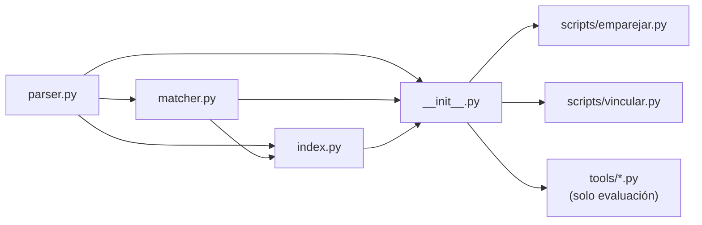
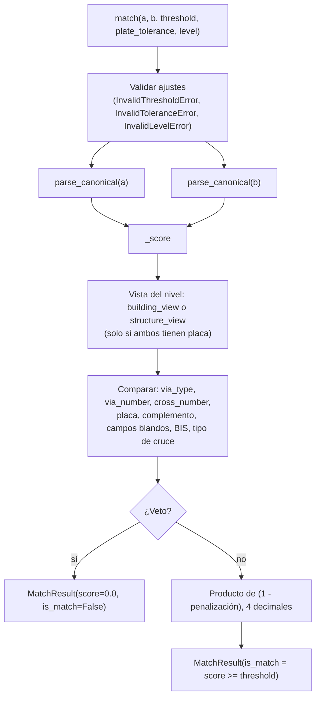
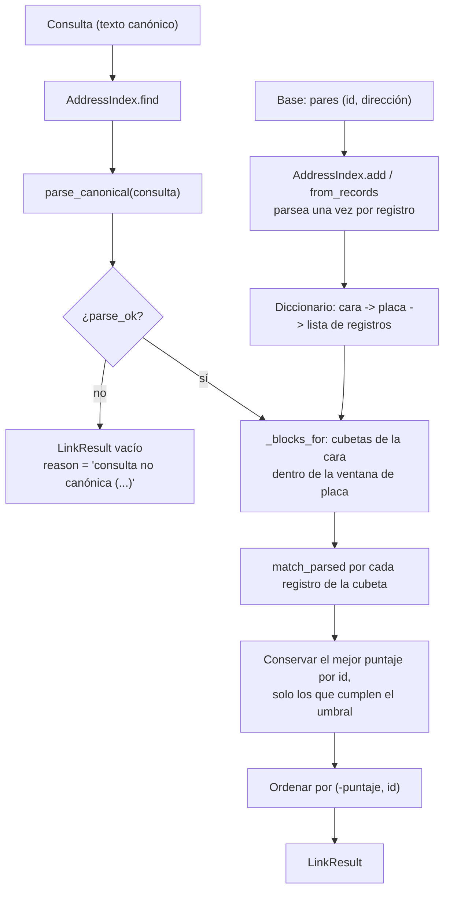
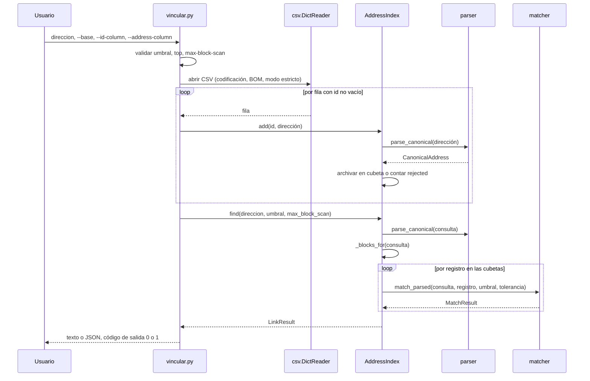

# 02 - Arquitectura

Este documento describe los módulos, los flujos de datos, la API pública y el comportamiento de rendimiento. Para la teoría del método ver [01](01-teoria.md); para los parámetros ver [03](03-configuracion.md).

## Contenido

1. [Mapa de módulos](#1-mapa-de-módulos)
2. [Flujo de datos](#2-flujo-de-datos)
3. [API pública](#3-api-pública)
4. [Complejidad y rendimiento](#4-complejidad-y-rendimiento)

## 1. Mapa de módulos

Tamaños verificados en el código fuente del proyecto.

| Archivo | Líneas | Bytes | Responsabilidad |
|---|---|---|---|
| `src/emparejador/parser.py` | 958 | 37 882 | `clean_text`, `parse_canonical`, `render`, `CanonicalAddress`, tablas `VIA_TYPES`, `COMPLEMENT_KINDS`, `QUADRANTS` |
| `src/emparejador/matcher.py` | 714 | 29 770 | `match`, `match_parsed`, `MatchResult`, `FieldComparison`, penalizaciones, vetos, niveles |
| `src/emparejador/index.py` | 281 | 11 442 | `AddressIndex`, `Candidate`, `LinkResult` (índice con bloqueo) |
| `src/emparejador/__init__.py` | 55 | 1 457 | Reexporta la superficie pública |
| `scripts/emparejar.py` | 129 | 3 962 | CLI de comparación de dos direcciones |
| `scripts/vincular.py` | 276 | 11 337 | CLI de vinculación contra una base CSV |
| `tools/eval_catastro.py` | 1 497 | 63 696 | Evaluación contra el catastro completo (secciones A a H) |
| `tools/build_groundtruth.py` | 1 032 | 42 685 | Generador de pares de verdad de referencia |
| `tools/eval_groundtruth.py` | 649 | 27 985 | Evaluador de pares de verdad de referencia |
| `tools/eval_realworld.py` | 929 | 41 168 | Evaluación con texto real sucio y etiquetas derivadas de GPS |

Dependencias entre módulos: `matcher` importa de `parser`; `index` importa de `matcher` y `parser`; los scripts importan del paquete. No hay dependencias de terceros en tiempo de ejecución. No existe `pyproject.toml`: los scripts agregan `src/` a `sys.path`.

## 2. Flujo de datos

### Comparación de un par (`match`)

### Vinculación contra una base (`AddressIndex`)

### Secuencia de `vincular.py`

## 3. API pública

Todo se importa desde `emparejador` (`src/emparejador/__init__.py`).

### Funciones

| Función | Firma resumida | Descripción |
|---|---|---|
| `match` | `match(a, b, threshold=0.90, plate_tolerance=0, *, level="unit") -> MatchResult` | Compara dos cadenas. No lanza por entrada de dirección mala (la puntúa 0,0); lanza por ajustes inválidos |
| `match_parsed` | igual que `match` pero con dos `CanonicalAddress` | Evita volver a parsear |
| `parse_canonical` | `parse_canonical(raw) -> CanonicalAddress` | Nunca lanza; `parse_ok=False` y `notes` ante fallo |
| `clean_text` | `clean_text(raw: str) -> str` | Capa de higiene |
| `render` | `render(addr) -> str` | Forma canónica espaciada; devuelve `raw` si no se pudo leer |
| `building_view`, `structure_view` | `(addr) -> CanonicalAddress` | La dirección tal como la compara cada nivel |

### Constantes

`DEFAULT_THRESHOLD = 0.90`, `DEFAULT_PLATE_TOLERANCE = 0`, `DEFAULT_LEVEL = "unit"`, `LEVELS = ("unit", "building", "structure")`, `BUILDING_IGNORED_KINDS`, `STRUCTURE_UNIT_KINDS`, `STRUCTURE_DISTINGUISHING_KINDS`. Además, `parser.py` exporta `VIA_TYPES`, `COMPLEMENT_KINDS`, `QUADRANTS`, `OPAQUE_KIND` (`"?"`) y `MAX_PLATE_DIGITS` (6).

### Excepciones (subclases de `ValueError`)

| Excepción | Cuándo |
|---|---|
| `InvalidThresholdError` | Umbral no numérico, `NaN`, booleano, o fuera de [0, 1] |
| `InvalidToleranceError` | Tolerancia de placa negativa, booleana o no entera |
| `InvalidLevelError` | `level` fuera de `LEVELS` |

`AddressIndex.find` lanza `ValueError` si `max_block_scan` no es un entero mayor o igual a 1 (o `None`), y `AddressIndex.add` lanza `TypeError` si el id no es hashable.

### `CanonicalAddress` (dataclass inmutable con `slots`)

| Campo | Tipo | Significado |
|---|---|---|
| `raw` | `str` | Entrada original |
| `parse_ok` | `bool` | Si la gramática consumió toda la entrada |
| `notes` | `tuple[str, ...]` | Motivos del fallo (vacío si `parse_ok`) |
| `via_type` | `str \| None` | Tipo de vía canónico (`CL`, `KR`...) |
| `via_number` | `str \| None` | Número de vía, sin ceros a la izquierda |
| `via_letters` | `str \| None` | Letra de la vía |
| `via_suffix` | `str \| None` | Número sufijo de la vía |
| `via_suffix_letters` | `str \| None` | Letra del sufijo |
| `via_bis` | `bool` | Presencia de BIS |
| `via_quadrant` | `str \| None` | `NORTE`, `SUR`, `ESTE`, `OESTE` |
| `cross_type`, `cross_number`, `cross_letters`, `cross_suffix`, `cross_suffix_letters`, `cross_bis`, `cross_quadrant` | idem | Los mismos campos para la vía generadora |
| `plate` | `str \| None` | Placa con letra final opcional (por ejemplo `20A`) |
| `complement` | `tuple[tuple[str, str], ...]` | Pares `(tipo, valor)` ordenados; tipo `?` para cola que empieza con dígito |

### `FieldComparison` (dataclass inmutable)

`field: str`, `a: str | None`, `b: str | None`, `status: str`, `penalty: float`, `veto: bool`, y `to_dict()`. Valores de `status`: `ausente_en_ambos`, `igual`, `solo_en_uno`, `difiere`, `equivalente` (placa igual salvo ceros), `dentro_tolerancia`.

### `MatchResult` (dataclass inmutable)

| Campo | Tipo | Significado |
|---|---|---|
| `is_match` | `bool` | `score >= threshold` y sin veto |
| `score` | `float` | De 0,0 a 1,0, 4 decimales |
| `threshold` | `float` | Umbral aplicado |
| `reason` | `str` | Texto en español: `coincidencia exacta`, `coincide; diferencias menores: ...`, `puntaje X < umbral Y: ...`, `veto: ...` |
| `parsed_a`, `parsed_b` | `CanonicalAddress` | Siempre los lados originales leídos |
| `fields` | `tuple[FieldComparison, ...]` | Una entrada por campo comparado (vacía si hubo fallo de lectura) |
| `warnings` | `tuple[str, ...]` | `sin_placa`, `sin_cruce`, `complemento_no_estructurado` |

Método `to_dict()` devuelve un diccionario serializable en JSON.

### `AddressIndex`

| Miembro | Descripción |
|---|---|
| `AddressIndex(plate_tolerance=0)` | Constructor; la tolerancia queda fija para el índice |
| `from_records(records, plate_tolerance=0)` | Construye desde pares `(id, dirección)` |
| `add(record_id, address) -> bool` | `False` y `rejected += 1` si no se puede leer |
| `find(query, threshold=0.90, max_block_scan=None, *, level="unit") -> LinkResult` | Consulta; nunca lanza por consulta mala |
| `stats() -> dict` | `records` (ids distintos), `blocks`, `rejected`, `max_block_size` |
| `len(index)` | Ids distintos indexados |
| `rejected` | Contador de registros no leídos |

### `Candidate` y `LinkResult`

| Tipo | Campo o propiedad | Significado |
|---|---|---|
| `Candidate` | `record_id`, `score`, `result` (`MatchResult`) | Un registro que alcanzó el umbral |
| `LinkResult` | `query` (`CanonicalAddress`), `threshold`, `candidates`, `n_compared`, `reason`, `truncated` | Campos |
| `LinkResult` | `parse_ok` | Si la consulta se pudo leer |
| `LinkResult` | `best` | Mejor candidato o `None` |
| `LinkResult` | `ambiguous` | Más de un id distinto empata en el mejor puntaje |
| `LinkResult` | `alternatives` | Cantidad de otros ids distintos sobre el umbral |
| `LinkResult` | `near_ambiguous` | `alternatives > 0` (señal más amplia que `ambiguous`) |

Los ids se comparan con la igualdad de Python (`1`, `1.0` y `True` son el mismo id; `1` y `"1"` son distintos). Los candidatos se ordenan por puntaje descendente y luego por id, con un orden estable también para ids de tipos mixtos.

## 4. Complejidad y rendimiento

Complejidad (derivada del código):

| Operación | Costo |
|---|---|
| `parse_canonical` | Lineal en la longitud de la cadena; la cola está acotada a 40 caracteres |
| `match_parsed` | Constante: 16 comparaciones de campos más ordenar un complemento pequeño |
| `AddressIndex.add` | Constante amortizado (parseo más inserción en diccionario) |
| `AddressIndex.find` | Proporcional al número de registros en las cubetas de la ventana de placa (`2 x tolerancia + 1` placas como máximo), no al tamaño de la base |
| Memoria del índice | Lineal en el número de registros |

Las mediciones de rendimiento no se publican. Para medirlas localmente (pares por segundo, parseo, construcción del índice, memoria, latencia de consulta y registros comparados por consulta, un solo hilo) ejecute las secciones G y H de `tools/eval_catastro.py` (ver [04](04-evaluacion-y-calibracion.md) y [08](08-metricas-y-confiabilidad.md)). El costo de la construcción del índice y la memoria crecen linealmente con el número de registros.

El rendimiento depende del tamaño de las cubetas. En una base donde muchas direcciones compartan vía, cruce y placa (por ejemplo unidades de un edificio grande), `find` examina todas esas unidades; el parámetro `max_block_scan` acota ese costo a cambio de perder exhaustividad (ver [03](03-configuracion.md)).
