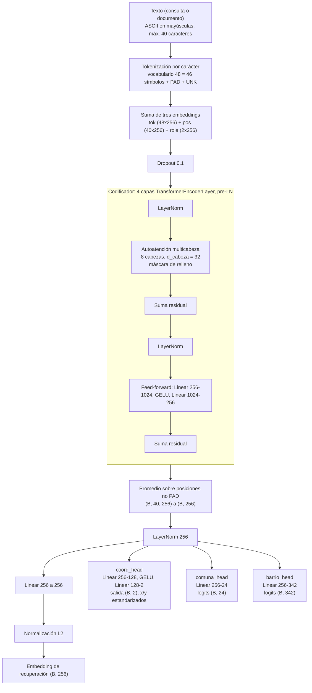
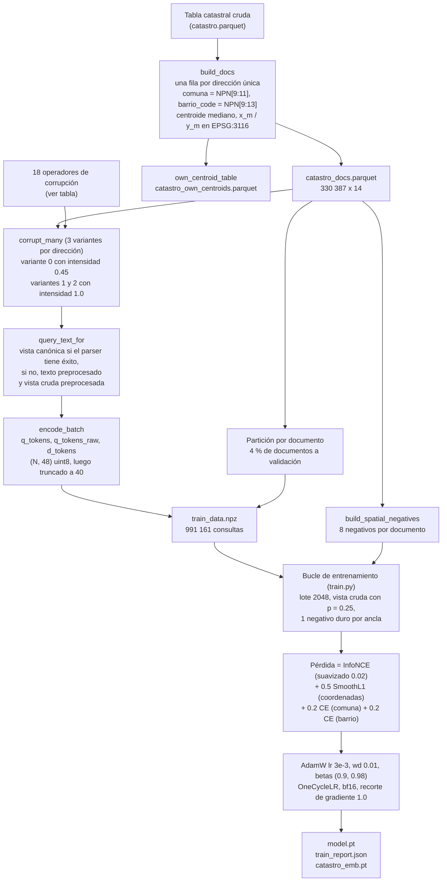
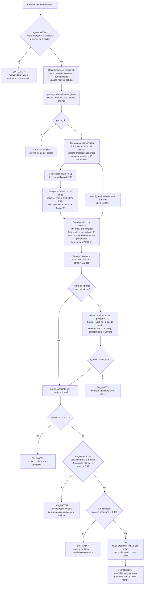
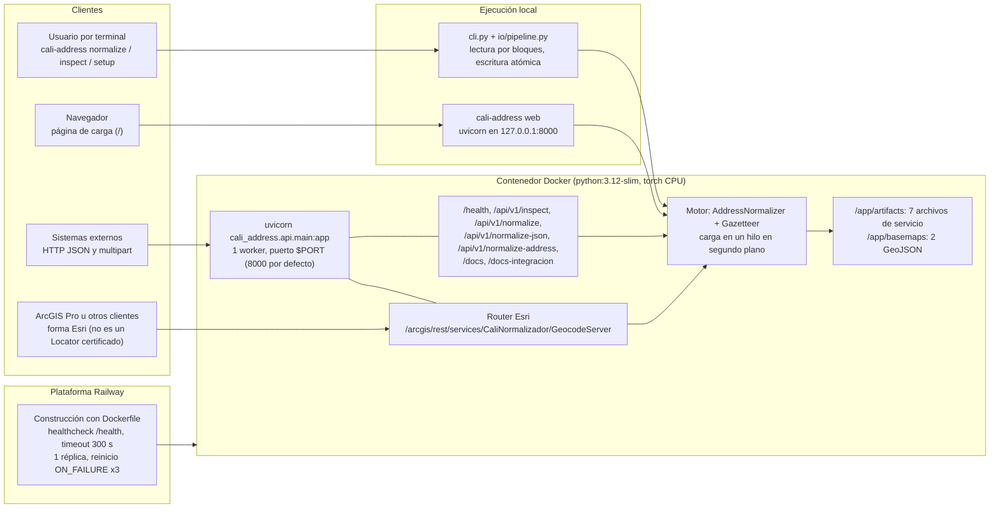

# 02. Arquitectura

Este documento describe los módulos del paquete `cali_address`, la red neuronal (con sus formas de tensor verificadas contra `src/cali_address/model.py` y contra el checkpoint `artifacts/model.pt`), el flujo de datos de entrenamiento, el flujo completo de inferencia y la topología de despliegue. Los fundamentos conceptuales están en [01-teoria.md](01-teoria.md); los parámetros de configuración, en [03-configuracion.md](03-configuracion.md).

## Contenido

1. [Mapa de módulos](#1-mapa-de-módulos)
2. [Red neuronal](#2-red-neuronal)
   - [a) Diagrama de bloques](#a-diagrama-de-bloques-de-la-red)
   - [b) Formas de tensor por capa](#b-formas-de-tensor-por-capa)
   - [Conteo de parámetros](#conteo-de-parámetros)
   - [Discrepancia entre los valores por defecto de `model.py` y el checkpoint](#discrepancia-entre-los-valores-por-defecto-de-modelpy-y-el-checkpoint)
3. [c) Canalización de datos de entrenamiento](#3-c-canalización-de-datos-de-entrenamiento)
4. [d) Flujo de inferencia de extremo a extremo](#4-d-flujo-de-inferencia-de-extremo-a-extremo)
5. [e) Diagrama de despliegue](#5-e-diagrama-de-despliegue)
6. [Superficies de uso (CLI y API)](#6-superficies-de-uso-cli-y-api)

## 1. Mapa de módulos

Todos los módulos están en `src/cali_address/`. Se listan por capa.

| Capa | Módulo | Responsabilidad |
|------|--------|-----------------|
| Gramática | `parser.py` | Normaliza texto (mayúsculas, ASCII, separadores) y produce `ParsedAddress` (tipo de vía, número, letras, sufijo, BIS, cuadrante, cruce, placa, complemento). Nunca lanza excepciones: una entrada no reconocida produce `parse_ok=False`. |
| Gramática | `complement_lexicon.py` | Léxico de complementos (torre, bloque, apartamento, etc.) usado por la etapa de complemento. |
| Territorio | `gazetteer.py` | Detecta barrio, vereda, comuna y corregimiento en el texto, los retira antes del análisis gramatical y filtra candidatos geográficamente (`gate_candidates`). Se alimenta de dos archivos GeoJSON de límites (no incluidos en este repositorio). |
| Territorio | `geo.py` | Proyección a EPSG:3116, distancia haversine y búsqueda punto-en-polígono (`ParcelIndex`). |
| Modelo | `model.py` | `AddressEncoder`: codificador Transformer a nivel de carácter con tres cabezas auxiliares. Vocabulario y codificación a enteros. |
| Entrenamiento | `augment.py` | Corrupción sintética: 18 operadores. |
| Entrenamiento | `realistic_noise.py`, `realpairs.py` | Variantes experimentales: ruido calibrado con cadenas reales y pares reales. No se usan en la receta de producción. |
| Entrenamiento | `dataset.py` | Construye el índice catastral (`build_docs`), el centroide propio de cada predio (`own_centroid_table`), los tensores de entrenamiento y los negativos duros (espaciales y de placa). |
| Entrenamiento | `train.py` | Bucle de entrenamiento, `embed_documents`, `recall_at_k`, guardado y carga de checkpoints. |
| Entrenamiento | `experiment.py`, `paths.py` | Infraestructura de experimentos aislados y resolución de directorios de artefactos. |
| Inferencia | `inference.py` | `AddressNormalizer`: carga el checkpoint y los embeddings, busca los 20 vecinos más cercanos por vista y calcula los componentes de puntaje (`score_components`). |
| Decisión | `service.py` | `normalize_strict`: puerta geográfica, umbral, reglas estrictas, ambigüedad, nivel de precisión y columnas de salida. |
| Decisión | `reliability.py` | Carga `reliability.json` y calcula `confiabilidad` y `confiabilidad_manzana`. |
| E/S | `tables.py`, `io/` | Lectura de tablas (CSV, Excel, Parquet, JSON, GeoJSON, shapefile, GeoPackage, SQL), mapeo de columnas, escritura atómica y canalización por bloques. |
| Interfaces | `cli.py`, `__main__.py` | Comandos `setup`, `normalize`, `web`, `inspect`, `formats`. |
| Interfaces | `api/main.py`, `api/schemas.py`, `api/esri.py` | Servicio FastAPI y router con forma Esri. |
| Evaluación | `evaluate.py`, `labels.py`, `eval_data.py` | Métricas estrictas y calidad de etiquetas. Solo para evaluación fuera de línea. |
| Evaluación | `evaluate.py` | Métricas de evaluación contra datos de referencia. El módulo de evaluación contra geocodificadores de terceros no se incluye en esta versión pública. |
| Arranque | `bootstrap.py` | Regenera `catastro_emb.pt` y ejecuta la autoverificación de `cali-address setup`. |

## 2. Red neuronal

El modelo es un **codificador dual con pesos compartidos**: un único Transformer a nivel de carácter embebe tanto la consulta (texto ruidoso) como el documento (dirección catastral canónica). Un embedding de rol (`role`, 0 para consulta y 1 para documento) indica al codificador de qué lado proviene la cadena. La recuperación es una búsqueda por similitud coseno en un espacio único de 256 dimensiones.

Los valores de esta sección se verificaron cargando `artifacts/model.pt` (diccionario con claves `state_dict`, `config`, `n_comuna`, `n_barrio`, `xy_mean`, `xy_std`, `comuna_codes`, `barrio_codes`) y comparando con `model.py`.

### a) Diagrama de bloques de la red

Notas de lectura:

- Las tres cabezas auxiliares leen la salida de `LayerNorm` (vector agrupado), no la proyección final.
- **En inferencia solo se usan el embedding de recuperación y `coord_head`.** `comuna_head` y `barrio_head` existen únicamente para dar señal durante el entrenamiento (verificado: ningún módulo fuera de `model.py` y `train.py` las referencia).
- El `TransformerEncoder` se construye sin normalización final por token; la `LayerNorm` posterior se aplica una sola vez, sobre el vector agrupado.
- Una fila completamente rellena haría que el softmax produjera NaN; `AddressEncoder.pool` mantiene viva la posición 0 para evitarlo.
- `logit_scale` es un parámetro aprendible (escalar). Se inicializa en `ln(1/0.05) = ln(20)` y se limita a `exp(.) <= 100` durante el entrenamiento.

### b) Formas de tensor por capa

Con `B` = tamaño de lote y `L` = 40 (longitud máxima del checkpoint), `d` = 256, `h` = 8, `d_h` = 32, `d_ff` = 1024.

| Etapa | Operación | Forma de entrada | Forma de salida | Parámetros |
|-------|-----------|------------------|-----------------|-----------:|
| 0 | Identificadores de carácter | texto | `(B, 40)` int64 | 0 |
| 1 | `tok`: Embedding(48, 256), `padding_idx=0` | `(B, 40)` | `(B, 40, 256)` | 12 288 |
| 2 | `pos`: Embedding(40, 256) | `(1, 40)` | `(1, 40, 256)` (difusión) | 10 240 |
| 3 | `role`: Embedding(2, 256), fila 0 o 1 | escalar | `(1, 1, 256)` (difusión) | 512 |
| 4 | Suma `tok + pos + role` y Dropout 0.1 | tres tensores | `(B, 40, 256)` | 0 |
| 5 | Por capa (x4): `LayerNorm` (norm1) | `(B, 40, 256)` | `(B, 40, 256)` | 512 |
| 5 | Por capa: `in_proj` de atención (Q, K, V juntos) | `(B, 40, 256)` | `(B, 40, 768)`, reorganizado a 3 x `(B, 8, 40, 32)` | 197 376 |
| 5 | Por capa: puntajes de atención `QK^T / sqrt(32)`, máscara, softmax | `(B, 8, 40, 32)` x2 | `(B, 8, 40, 40)` | 0 |
| 5 | Por capa: contexto y `out_proj` | `(B, 8, 40, 32)` | `(B, 40, 256)` | 65 792 |
| 5 | Por capa: suma residual | dos tensores | `(B, 40, 256)` | 0 |
| 5 | Por capa: `LayerNorm` (norm2) | `(B, 40, 256)` | `(B, 40, 256)` | 512 |
| 5 | Por capa: `linear1` 256 a 1024 y GELU | `(B, 40, 256)` | `(B, 40, 1024)` | 263 168 |
| 5 | Por capa: `linear2` 1024 a 256 | `(B, 40, 1024)` | `(B, 40, 256)` | 262 400 |
| 5 | Por capa: suma residual | dos tensores | `(B, 40, 256)` | 0 |
| 6 | Promedio sobre posiciones no PAD | `(B, 40, 256)` | `(B, 256)` | 0 |
| 7 | `norm`: LayerNorm(256) | `(B, 256)` | `(B, 256)` | 512 |
| 8 | `proj`: Linear(256, 256) | `(B, 256)` | `(B, 256)` | 65 792 |
| 9 | Normalización L2 | `(B, 256)` | `(B, 256)` unitario | 0 |
| 10a | `coord_head`: Linear(256, 128), GELU, Linear(128, 2) | `(B, 256)` | `(B, 2)` | 33 154 |
| 10b | `comuna_head`: Linear(256, 24) | `(B, 256)` | `(B, 24)` | 6 168 |
| 10c | `barrio_head`: Linear(256, 342) | `(B, 256)` | `(B, 342)` | 87 894 |
| - | `logit_scale` | - | escalar | 1 |

La capa del paso 5 pesa 789 760 parámetros y se repite cuatro veces (3 159 040).

Tensores del lado del índice y de la inferencia:

| Tensor | Forma y tipo | Notas |
|--------|--------------|-------|
| `d_tokens` (almacenado) | `(330 387, 48)` uint8 | Se trunca a 40 al entrenar y al embeber. |
| `q_tokens`, `q_tokens_raw` (almacenados) | `(991 161, 48)` uint8 | Dos vistas de cada consulta; se truncan a 40. |
| `doc_xy` | `(330 387, 2)` float32 | Coordenadas EPSG:3116 estandarizadas con `xy_mean` y `xy_std`. |
| `spatial_negatives.npy` | `(330 387, 8)` int64 | Ocho negativos espaciales por documento. |
| `catastro_emb.pt` | `(330 387, 256)` float16 | 169 159 756 bytes. Derivable de `model.pt` y `catastro_docs.parquet`. |
| Logits de entrenamiento | `(B, U)` | `U` = documentos únicos del lote (positivos más negativos duros), con `B` = 2048. |
| Candidatos por consulta | hasta 40 | 20 por vista, unidos y sin duplicados. |

### Conteo de parámetros

| Bloque | Parámetros |
|--------|-----------:|
| Embeddings (`tok`, `pos`, `role`) | 23 040 |
| 4 capas del codificador | 3 159 040 |
| `norm` y `proj` | 66 304 |
| `coord_head` | 33 154 |
| `comuna_head` | 6 168 |
| `barrio_head` | 87 894 |
| `logit_scale` | 1 |
| **Total** | **3 375 601** |

El total coincide con `n_params` de `artifacts/train_report.json` y con la suma de los tensores del `state_dict`. El camino de recuperación (sin `comuna_head` ni `barrio_head`) usa 3 281 539 parámetros.

### Discrepancia entre los valores por defecto de `model.py` y el checkpoint

La clase `AddressEncoder` define valores por defecto que **no coinciden** con el modelo publicado. Lo que se carga es siempre la configuración almacenada en el checkpoint (`inference.AddressNormalizer` y `train.load_checkpoint` construyen el modelo a partir de `ckpt["config"]`).

| Parámetro | Valor por defecto en `model.py` | Valor en el checkpoint | Efecto |
|-----------|--------------------------------|------------------------|--------|
| `n_layers` | 5 | **4** | Un modelo construido con los valores por defecto no puede cargar el `state_dict`. |
| `max_len` / `MAX_LEN` | 48 (constante del módulo) | **40** | Las matrices de tokens se almacenan a 48 y se truncan a 40; `pos` tiene 40 filas. |
| `n_barrio` | 400 | **342** | Solo afecta a `barrio_head`. |
| `n_comuna` | 24 | 24 | Coincide. |
| Vocabulario | 48 | 48 | Coincide (46 símbolos más PAD y UNK). |

Recomendación para quien extienda el código: construir siempre el modelo desde `config` y no confiar en los valores por defecto del constructor.

El `config` del checkpoint no contiene `label_smoothing`, `init_temperature`, `pct_start`, `div_factor` ni `final_div_factor`. Los valores de la receta (0.02, 0.05, 0.15, 25 y 100) provienen de los valores por defecto actuales de `TrainConfig`; no se pudo verificar que fueran idénticos al momento del entrenamiento original.

## 3. c) Canalización de datos de entrenamiento

El modelo se entrena **solo con datos sintéticos**: cada dirección del catastro se corrompe con los 18 operadores de `augment.py` para simular el texto que escriben las personas. La receta de producción no usa pares reales (el `config` del checkpoint no contiene `real_frac`).

Los 18 operadores (`augment.OPERATIONS`), con la probabilidad base de cada uno en `corrupt` (se multiplican por la intensidad: 0.45 en la primera variante y 1.0 en las demás):

| Operador | Efecto | Probabilidad base |
|----------|--------|-------------------|
| `expand_via_type` | `KR` a `CARRERA`, `Cra.`, `K`, etc. | 0.75 |
| `expand_cross_type` | Tipo de la vía de cruce expandido | 0.4 |
| `hash_variant` | `#` reemplazado por `No.`, `Nro`, `N°`, vacío, etc. | 0.65 |
| `plate_separator` | Separador de placa variado (`-`, espacio, `_`, etc.) | 0.6 |
| `glue_letters` | `12 A` a `12A` | 0.35 |
| `glue_all` | Pegado de `#` y de tipo con número (dos pasos independientes) | 0.25 y 0.12 |
| `lowercase` | Minúsculas (30 %) o formato título (12 % adicional) | 0.30 y 0.12 (escalado por intensidad) |
| `city_suffix` | `, Cali, Valle del Cauca` y variantes | 0.18 |
| `barrio_suffix` | Sufijo de barrio (lista fija de barrios reales de Cali) | 0.10 |
| `add_complement` | Añade una unidad (`APTO 301`, `TORRE 2`, etc.) | 0.22 sin complemento, 0.20 si ya hay uno |
| `drop_complement` | Elimina el complemento existente | 0.55 |
| `typo` | Intercambio, borrado, duplicado o sustitución de caracteres | 0.22 |
| `ordinal` | `1` a `1ra`, `7` a `7ma` (solo si el número de vía tiene un dígito) | 0.06 |
| `quadrant_abbrev` | `NORTE` a `Nte.`, `N`, etc. | 0.55 |
| `unpad_plate` | Quita el cero a la izquierda de la placa | 0.30 |
| `drop_plate` | Elimina la placa | 0.05 |
| `whitespace_jitter` | Duplica un espacio | 0.10 |
| `duplicate_address` | Repite la dirección completa | 0.04 |

Aspectos que conviene conocer:

- Los comentarios del código indican que los operadores se eligieron tras revisar cinco libros de evaluación reales. Esos libros no forman parte de este repositorio. El generador sintético incorpora, por tanto, conocimiento del tipo de ruido observado en datos de Cali.
- `CITY_SUFFIXES`, `BARRIO_SUFFIXES` y `COMPLEMENTS` contienen nombres de barrios y ciudad específicos de Cali (`augment.py:32-39`).
- La partición de validación es por documento: ninguna dirección catastral de validación aparece como positivo en entrenamiento. La validación sintética mide qué tan bien se recupera el documento correcto bajo el **mismo** generador de ruido con que se entrenó; no equivale a texto real (ver [08-metricas-y-confiabilidad.md](08-metricas-y-confiabilidad.md)).
- Los negativos duros espaciales (`build_spatial_negatives`) llenan los dos primeros de ocho espacios con direcciones de la misma manzana cuando existen; el resto proviene de los centroides más cercanos. El bucle toma uno de los ocho al azar para cada ancla (`n_hard_neg = 1`).

## 4. d) Flujo de inferencia de extremo a extremo

El flujo siguiente corresponde a `service.normalize_strict` (ruta de la CLI, de la API y de la canalización de archivos). Los números son los valores por defecto verificados en el código y en `tuning.json`.

Detalles verificados que el diagrama no muestra:

- Los componentes `sim`, `fuzz`, `struct` y `geo` se calculan en `inference.AddressNormalizer.score_components`; la fusión y las decisiones, en `service._build_row`.
- `geo` usa la distancia entre el centroide del documento (`x_m`, `y_m`) y la coordenada predicha por `coord_head`, desestandarizada con `xy_mean` y `xy_std` del checkpoint.
- Un candidato que solo falla la regla de sufijo numérico presente en un solo lado sigue contando como competidor al calcular `margen`.
- Las violaciones blandas por defecto son: letra de vía presente en un solo lado y diferencia de placa de 1 a 2 unidades. Una fila con una violación blanda permanece `OK` pero con `nivel_precision` limitado (`esquina` o `manzana`).
- Una dirección compartida por varios predios devuelve el primer predio (menor `OBJECTID`) y degrada el nivel a `manzana` o `direccion`.
- La salida `confiabilidad` no interviene en la decisión de `estado`.
- Si no hay `gazetteer.pkl` ni límites en `basemaps/`, el gazetteer se desactiva (`load_gazetteer` devuelve `None` con una advertencia): no hay detección de lugar ni puerta geográfica.

## 5. e) Diagrama de despliegue

Puntos de diseño del despliegue:

- **Un solo worker.** Cada proceso trabajador mantiene su propia copia del modelo y de los 330 387 embeddings; un segundo trabajador duplicaría aproximadamente la memoria residente.
- **Carga diferida en segundo plano.** El puerto se abre de inmediato; `/health` responde 503 con `status: loading` hasta que el modelo y el índice están en memoria, y los endpoints de normalización esperan hasta `WARMUP_TIMEOUT_S` segundos.
- **Imagen de CPU.** `NORMALIZER_DEVICE=cpu` por defecto; torch se instala en una capa propia desde el índice de ruedas de CPU.
- **Sin persistencia de cargas.** Los bytes recibidos por `multipart/form-data` se procesan en memoria y no se escriben a disco.
- El contenedor requiere que `deploy/artifacts/` exista en el momento de construir. En este repositorio **no se distribuyen** los archivos que dependen de datos catastrales; ver [07-requisitos.md](07-requisitos.md) y [05-uso-e-implementacion.md](05-uso-e-implementacion.md).

## 6. Superficies de uso (CLI y API)

| Superficie | Punto de entrada | Descripción |
|------------|------------------|-------------|
| CLI | `cali-address` o `python -m cali_address` | Subcomandos `setup`, `normalize`, `web`, `inspect`, `formats`. Códigos de salida 0, 1, 2, 3, 4 y 130. |
| Biblioteca | `cali_address.service.normalize_strict` | Misma ruta que CLI y API. Devuelve un `DataFrame` con las columnas de `OUTPUT_COLUMNS`. |
| Biblioteca | `cali_address.inference.AddressNormalizer.normalize_batch` | Ruta antigua, siempre devuelve el mejor candidato aunque la entrada sea basura. Se conserva para scripts de ablación y evaluación; no es la ruta de producción. |
| API HTTP | `GET /health` | Estado del servicio (200 o 503). |
| API HTTP | `POST /api/v1/inspect` | Lee un archivo sin normalizar; devuelve formato, columnas, columna sugerida y vista previa. |
| API HTTP | `POST /api/v1/normalize` | Normaliza un archivo (`multipart/form-data`); salida `json`, `xlsx`, `csv` o `geojson`. |
| API HTTP | `POST /api/v1/normalize-json` | Normaliza registros en memoria (`records` y `address_field`) o una lista (`addresses`). |
| API HTTP | `POST /api/v1/normalize-address` | Alias mínimo que solo acepta `addresses`. |
| API HTTP | `GET /docs`, `GET /docs-integracion` | Swagger UI generada por FastAPI y la guía de integración renderizada desde `docs/API.md`. |
| Forma Esri | `GET` y `POST .../GeocodeServer/findAddressCandidates`, `POST .../geocodeAddresses` | Reproduce solo la forma JSON de ArcGIS REST. No es un Locator registrado. |

Diferencia relevante entre superficies: la CLI y la canalización de archivos pueden devolver, además de `OK`, `SIN_MATCH` y `NO_PARSEABLE`, los estados `FUERA_DE_AREA` (con `--municipality-col`) y `ERROR`; la API HTTP expone solo los tres primeros.

Ejemplos de uso en [05-uso-e-implementacion.md](05-uso-e-implementacion.md); interpretación de cada columna en [06-predicciones.md](06-predicciones.md).
