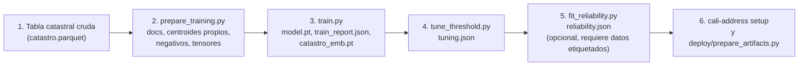

# 04. Entrenamiento

> Aviso de publicación: los resultados de ejecución citados como fuentes en este documento (`strict_eval_*`, `eval_calibration.csv`, `threshold_*.csv`, `splits_report.json`, `train_report.json`, `artifacts/experiments/`) ya no se versionan en el repositorio. Las cifras no se publican; para obtenerlas se regeneran localmente con los scripts de `scripts/` (ver [04-entrenamiento.md](04-entrenamiento.md)), y no hay garantía de que coincidan bit a bit.

Receta paso a paso para reconstruir el modelo a partir de un catastro propio. Los pasos están extraídos de los scripts reales de `scripts/` y de los módulos de `src/cali_address/`. Aquí no se distribuye ningún dato catastral; el lector debe aportar su propia tabla (esquema en la sección 2). Para los requisitos resumidos véase [07-requisitos.md](07-requisitos.md); para qué cambiar en otro territorio, [10-estandar-y-generalizacion.md](10-estandar-y-generalizacion.md).

## Contenido

1. [Visión general](#1-visión-general)
2. [Datos de entrada requeridos](#2-datos-de-entrada-requeridos)
3. [Etiquetas de comuna y barrio y adaptación a otros territorios](#3-etiquetas-de-comuna-y-barrio-y-adaptación-a-otros-territorios)
4. [Receta paso a paso](#4-receta-paso-a-paso)
5. [Tensores e hiperparámetros](#5-tensores-e-hiperparámetros)
6. [Hardware y tiempos](#6-hardware-y-tiempos)
7. [Semillas y no determinismo](#7-semillas-y-no-determinismo)
8. [Ajuste de pesos y umbral](#8-ajuste-de-pesos-y-umbral)
9. [Ajuste de la confiabilidad](#9-ajuste-de-la-confiabilidad)
10. [Salidas](#10-salidas)
11. [Verificación posterior](#11-verificación-posterior)

## 1. Visión general



La receta de producción usa solo datos sintéticos derivados del catastro. Los pasos 1 a 4 no necesitan ningún dato privado. El paso 5 sí necesita filas reales con referencia conocida; hay una alternativa en la sección 9.

## 2. Datos de entrada requeridos

### 2.1 Tabla catastral cruda (`artifacts/catastro.parquet`)

Una fila por predio. `dataset.build_docs` exige las columnas marcadas como obligatorias; las demás las produce el script de descarga original pero no las usa el entrenamiento.

| Columna | Tipo (pandas) | Obligatoria | Uso |
|---------|---------------|:-----------:|-----|
| `OBJECTID` | `int64` | sí | Identificador del predio; criterio de orden y de desempate (se reporta el primer predio por `OBJECTID` de una dirección compartida). |
| `numero_predial_nacional` | `object` (texto de 30 dígitos) | sí | NPN. Se reparte por posiciones en comuna y barrio (sección 3). |
| `numero_predial_manzana` | `object` (texto) | sí | Código de manzana catastral (17 caracteres en la mayoría de los registros del catastro de Cali). |
| `direccion` | `object` (texto) | sí | Dirección catastral. Es la cadena que se corrompe, se embebe y se devuelve. |
| `centroid_lon`, `centroid_lat` | `float64` | sí | Centroide del predio en EPSG:4326 (grados). |
| `geom_wkb` | `object` (bytes WKB, EPSG:4326) | no | Polígono del predio; solo lo usan scripts de evaluación (`ParcelIndex`). |
| `direccion_py`, `id_predio_sis` | `object` | no | No se usan al entrenar. |
| `area_terreno`, `MAX_numero_pisos`, `Shape__Area` | `float64` | no | No se usan al entrenar. |

Requisitos de contenido:

- `direccion` debe seguir una gramática de nomenclatura "vía # cruce - placa" razonablemente uniforme. El parser, el generador de ruido y las reglas asumen ese patrón (tipos de vía `KR`, `CL`, `AV`, `DG`, `TV`, etc.).
- El NPN debe tener 30 posiciones numéricas. Los registros con otra longitud se conservan, pero `motivo` los marca (`NPN anomalo en catastro`).
- Filas sin dirección o sin centroide se descartan en `build_docs`.
- Es recomendable que el índice contenga solo la zona urbana: el índice de Cali procede de la capa catastral urbana.

### 2.2 Tabla de documentos derivada (`artifacts/catastro_docs.parquet`)

`build_docs` agrupa por dirección única (`direccion` con espacios normalizados) y produce 14 columnas. Se obtiene una fila por dirección única, por lo que hay menos filas que predios.

| Columna | Tipo | Descripción |
|---------|------|-------------|
| `direccion` | `object` | Dirección única. |
| `numero_predial_nacional` | `object` | NPN del primer predio (menor `OBJECTID`). |
| `manzana` | `object` | Manzana del primer predio. |
| `comuna` | `object` | `NPN[9:11]`. |
| `barrio` | `object` | `NPN[11:13]` (no se usa en inferencia). |
| `barrio_code` | `object` | `NPN[9:13]`. |
| `centroid_lon`, `centroid_lat` | `float64` | Mediana de los centroides de los predios que comparten la dirección. |
| `n_predios` | `int64` | Cantidad de predios con esa dirección. |
| `manzana_nunique` | `int64` | Cantidad de manzanas distintas bajo la dirección. |
| `objectid` | `int64` | `OBJECTID` del primer predio. |
| `x_m`, `y_m` | `float64` | Coordenadas métricas en EPSG:3116. |
| `doc_id` | `int64` | Índice consecutivo del documento (alineado con las filas de `catastro_emb.pt`). |

`catastro_own_centroids.parquet` (columnas `objectid`, `numero_predial_nacional`, `own_lon`, `own_lat`, una fila por documento y en el mismo orden) conserva el centroide del predio realmente reportado, porque el de `catastro_docs.parquet` es la mediana de la dirección. El motor solo acepta el archivo si coincide fila a fila con los documentos.

## 3. Etiquetas de comuna y barrio y adaptación a otros territorios

Las etiquetas auxiliares de entrenamiento se derivan del NPN por posición (`dataset.py:44-46`, índices base 0):

| Etiqueta | Corte | Posiciones del NPN (base 1) | Clases en Cali |
|----------|-------|-----------------------------|---------------:|
| `comuna` | `NPN[9:11]` | 10-11 | 24 (cadena vacía, `01` a `22` y `56`) |
| `barrio_code` | `NPN[9:13]` | 10-13 | 342 |

Observación sobre el índice de Cali: los dígitos 8-9 del NPN (el "sector" del estándar nacional) valen `00` en casi todos los documentos, y los dígitos 6-7 (zona) valen `01` en casi todos. Por eso la comuna se lee en los dos primeros dígitos del campo de barrio y no en el campo de sector. Es una convención de Cali, no del estándar.

Qué cambiar para otro territorio:

1. **Cortes del NPN** en `dataset.build_docs` (`dataset.py:44-46`), `evaluate.py` y `build_splits.py`: ajustar al significado local de las posiciones 8-13.
2. **Número de clases.** Los tamaños de `comuna_head` y `barrio_head` se calculan como `max(índice) + 1` sobre los códigos presentes en los datos de entrenamiento; se guardan en el checkpoint (`n_comuna`, `n_barrio`, `comuna_codes`, `barrio_codes`).
3. **Proyección métrica.** `geo.METRIC_CRS = "EPSG:3116"` está fijo. Fuera de la zona Bogotá de MAGNA-SIRGAS, cambiarlo por un CRS métrico adecuado.
4. **Generador de ruido.** Revisar `augment.py` (sufijos de ciudad, barrios, complementos).
5. **Parser y léxico.** Revisar los tipos de vía, la convención de cuadrantes y el ruido de ciudad en `parser.py`.

La lista completa de elementos específicos de Cali, con archivo y línea, está en [09-advertencias-y-limitaciones.md](09-advertencias-y-limitaciones.md).

## 4. Receta paso a paso

Todos los comandos se ejecutan desde la raíz del repositorio. Los scripts importan el paquete mediante `sys.path`, por lo que no exigen instalación; las dependencias sí.

### Paso 0. Entorno

```bash
# Entrenamiento: instale la versión de torch con CUDA que corresponda a su GPU (ver pytorch.org)
pip install -e ".[train]"
```

Notas: la extensión `train` añade `scikit-learn` (negativos espaciales), `requests`, `nbformat`, `nbclient` y `unidecode`. Para usar los scripts de `scripts/` con módulos del paquete se recomienda `PYTHONPATH=src`.

### Paso 1. Obtener la tabla catastral

Coloque su tabla con el esquema de la sección 2.1 en `artifacts/catastro.parquet`. El script original `scripts/download_catastro.py` descarga la capa catastral municipal desde un servicio de entidades de ArcGIS cuya URL usted debe entregar en la variable de entorno `CALI_CATASTRO_URL` (no hay fuente por defecto; use solo una fuente que esté autorizado a consultar). La descarga es paginada y reanudable y escribe `artifacts/catastro.parquet` y `artifacts/catastro_meta.json`. Para otra fuente, apunte `CALI_CATASTRO_URL` a ella, ajuste la lista `FIELDS` del script o produzca el parquet por otro medio; el contenido de `catastro_meta.json` es solo informativo.

### Paso 2. Preparar los datos de entrenamiento

```bash
python scripts/prepare_training.py
```

Produce en `artifacts/`: `catastro_docs.parquet`, `catastro_own_centroids.parquet`, `spatial_negatives.npy` (330 387 x 8) y `train_data.npz`.

`train_data.npz` contiene: `q_tokens`, `q_tokens_raw` (991 161 x 48, `uint8`), `d_tokens` (330 387 x 48, `uint8`), `q_doc` (`int64`), `q_is_val` (booleano), `doc_comuna`, `doc_barrio` (`int64`), `doc_xy` (`float32`, estandarizado), `xy_mean`, `xy_std` (`float64`), `comuna_codes`, `barrio_codes` (arreglos de objetos).

### Paso 3. Entrenar el codificador

```bash
PYTHONPATH=src python scripts/train.py
```

Con los valores por defecto reproduce la receta de producción (sección 5). Escribe `model.pt`, `train_report.json` y `catastro_emb.pt` en `artifacts/` (o en el directorio indicado con `--out-dir`) y un `experiment.json` con la configuración, las huellas del código y las métricas finales. Variantes:

```bash
PYTHONPATH=src python scripts/train.py --smoke          # corrida mínima de verificación, no guarda en producción
PYTHONPATH=src python scripts/train.py --out-dir artifacts/experiments/mi_prueba --tag mi_prueba
```

Si `model.pt` existe pero falta `catastro_emb.pt` (por ejemplo, una falla al embeber), `finish_training_artifacts.py` los regenera sin reentrenar:

```bash
PYTHONPATH=src python scripts/finish_training_artifacts.py
```

### Paso 4. Ajustar pesos de fusión y umbral

```bash
PYTHONPATH=src python scripts/tune_threshold.py
```

Detalles en la sección 8. Produce `tuning.json`, `threshold_sweep.csv`, `weight_sweep.csv` y `threshold_junk_sensitivity.csv`.

### Paso 5. Ajustar la confiabilidad (opcional)

```bash
PYTHONPATH=src python scripts/fit_reliability.py --rows <filas_de_evaluacion.parquet>
```

Requiere filas reales con referencia conocida (sección 9). Sin este paso, `confiabilidad` y `confiabilidad_manzana` salen `null`.

### Paso 6. Dejar el sistema listo para servir

```bash
cali-address setup                       # verifica archivos, regenera catastro_emb.pt si falta, autoverificación
python deploy/prepare_artifacts.py       # copia los 7 archivos de servicio a deploy/artifacts/ para Docker
```

Los siete archivos de servicio son: `model.pt`, `catastro_emb.pt`, `catastro_docs.parquet`, `tuning.json`, `gazetteer.pkl`, `reliability.json` y `catastro_own_centroids.parquet`. `gazetteer.pkl` se reconstruye automáticamente a partir de los GeoJSON de `basemaps/` la primera vez que se carga el gazetteer.

### Escenario de solo predicción con el modelo publicado

Para usar el `model.pt` publicado (Cali) sin reentrenar, solo hace falta construir el índice con su propio catastro de Cali. Los pasos 1 y 2 completos generan además tensores de entrenamiento que no se necesitan; la ruta mínima es:

```python
# Ejecutar desde la raíz del repositorio, con las dependencias instaladas
import sys
sys.path.insert(0, "src")
import pandas as pd
from cali_address.dataset import build_docs, own_centroid_table

catastro = pd.read_parquet("artifacts/catastro.parquet")        # esquema de la sección 2.1
docs = build_docs(catastro)
docs.to_parquet("artifacts/catastro_docs.parquet", index=False)
own_centroid_table(docs, catastro).to_parquet("artifacts/catastro_own_centroids.parquet", index=False)
```

Después, `cali-address setup` calcula `catastro_emb.pt`. Este recorrido se comprobó con una tabla inventada de tres filas (en memoria, sin escribir archivos); no se ejecutó extremo a extremo con un catastro completo en la elaboración de esta documentación.

## 5. Tensores e hiperparámetros

Valores de configuración, verificados en la configuración del checkpoint y en `TrainConfig`. Los resultados de cada corrida (`artifacts/train_report.json`) no se publican.

| Concepto | Valor |
|----------|-------|
| Variantes por documento | 3 (intensidad 0.45, 1.0 y 1.0) |
| Partición de validación | 4 % de los documentos (por documento) |
| Longitud almacenada / de entrenamiento | 48 / 40 caracteres |
| Tamaño de lote | 2048 consultas, más sus positivos y un negativo duro por ancla |
| Épocas | 8 |
| Optimizador | AdamW, `lr` 3e-3, `weight_decay` 0.01, betas (0.9, 0.98), `eps` 1e-8 |
| Planificador | OneCycleLR: `max_lr` 3e-3, `pct_start` 0.15, `div_factor` 25, `final_div_factor` 100 |
| Recorte de gradiente | 1.0 |
| Precisión | bf16 con `autocast` en CUDA; TF32 y `cudnn.benchmark` activados |
| Vista cruda de la consulta | probabilidad 0.25 (`p_raw_view`) |
| Pérdidas | InfoNCE con suavizado 0.02; SmoothL1 (`beta` 0.2) con peso 0.5; CE de comuna 0.2; CE de barrio 0.2 |
| Temperatura inicial | 0.05 (`logit_scale = ln 20`), aprendible, tope `exp <= 100` |
| Parámetros | 3 375 601 |
| Semilla | 42 |
| Presupuesto de tiempo | `max_minutes` 24 (el script detiene el entrenamiento al excederlo) |

Los resultados de validación sintética por época (recall@1, @5 y @20) los escribe `train.py` en `train_report.json`; no se publican. Son sintéticos; ver [08-metricas-y-confiabilidad.md](08-metricas-y-confiabilidad.md).

## 6. Hardware y tiempos

Los tiempos, el rendimiento y el pico de memoria de GPU de las corridas no se publican; se miden localmente (`train_report.json` registra el tiempo y la memoria de cada corrida). El entrenamiento original usó una GPU con bf16; la regeneración de `catastro_emb.pt` con `cali-address setup` es rápida en GPU y más lenta en CPU (la CLI lo indica).

El pico de memoria de GPU depende del tamaño de lote (2048) y de la longitud de secuencia (40); reducir `batch_size` modifica la dinámica de optimización y los negativos disponibles por lote. Entrenar en CPU es posible por código (`resolve_device` cae a `cpu`), pero no se midió.

## 7. Semillas y no determinismo

- Semilla 42 para `random`, `numpy` y `torch` (`train.set_seeds`); generador de aumentación inicializado con 42 (`dataset.SEED`); partición de validación con `numpy.random.default_rng(42)`; ajuste de umbral con `subsample_seed` 1234 y `augmentation_seed` 42.
- **El entrenamiento no es reproducible bit a bit.** Se activan `cudnn.benchmark` y TF32, y se usa bf16: el orden de las operaciones puede variar entre ejecuciones y entre GPU.
- Las repeticiones con distinta semilla difieren entre sí por un "piso de ruido" que los autores señalan; compare cualquier variante contra ese piso (tabla local `artifacts/experiments/leaderboard.csv`, no versionada).
- La infraestructura registra el hash SHA-256 de los archivos de servicio antes y después de cada experimento (`experiment.json`), para confirmar que la producción no se modifica.
- Regenerar `catastro_emb.pt` en CPU con `cali-address setup` no reproducirá bit a bit el archivo creado en GPU con bf16; la diferencia es de redondeo y no se cuantificó.

## 8. Ajuste de pesos y umbral

`scripts/tune_threshold.py` **no necesita ningún dato privado**: usa únicamente el catastro.

Procedimiento (verificado en el script y en `tuning.json`):

1. Reproduce de forma determinista la aumentación y conserva las consultas de validación.
2. Toma submuestras con semilla 1234: 10 000 positivos "en distribución" y 10 000 "difíciles" (nuevas corrupciones a intensidad 2.0); peso 0.5 cada grupo.
3. Genera 5 000 cadenas basura sintéticas (identificadores numéricos, letras al azar, descripciones genéricas, vacíos) con un vocabulario fijo dentro del script.
4. Calcula una vez los componentes de puntaje (`score_components`) y barre los pesos de fusión sobre una rejilla de paso 0.05, con el peso de `geo` obligado a ser al menos 0.1.
5. Entre las combinaciones a menos de un error estándar del óptimo y con todos los componentes activos, elige la más equilibrada.
6. Barre el umbral de 0.50 a 0.95 en pasos de 0.01 y elige el que maximiza F1 de "coincide implica documento correcto", suponiendo una tasa de basura de 0.2. La sensibilidad a esa suposición se informa para tasas de basura de 0.05 a 0.40.

Resultado (configuración que lee el código desde `tuning.json`): pesos 0.7 / 0.1 / 0.1 / 0.1 y umbral 0.73. Las métricas del ajuste se miden sobre documentos retenidos más basura sintética; no miden texto real y no se publican.

El ajuste compara variantes; la variante "solo neural" puede tener mejor F1 que la completa elegida, y se mantuvo la completa para conservar la capa de reglas.

## 9. Ajuste de la confiabilidad

`scripts/fit_reliability.py` necesita una tabla de filas reales ya normalizadas y comparadas con una referencia. Esquema genérico del archivo de filas (el que escribe `scripts/eval_strict.py`): una fila por dirección con `estado`, `has_gt` (¿hay referencia?), `correct_predial` y `correct_manzana` (0 o 1), `dataset` (fuente; la validación deja una fuente fuera cada vez, por lo que hacen falta al menos dos), `motivo`, `confianza` y las 13 columnas `feat_*` que escribe `eval_strict.py` (nombres en `reliability.FEATURE_NAMES`).

- El modelo publicado se ajustó con filas `OK` con referencia de varias fuentes. Esas filas son privadas y no se distribuyen. Las etiquetas provienen de una referencia por GPS (punto en polígono), ruidosa para el predio.
- **Regla de publicación del modelo `hybrid`:** el archivo solo se escribe en la ruta de producción si, fuera de muestra, el Brier no es más de 0.002 peor y el AUC no es menor que el de la regresión logística de referencia, en ambos objetivos; de lo contrario se escribe en un archivo candidato.
- **Alternativa sin datos etiquetados:** omitir el paso. El motor funciona sin `reliability.json`; las columnas de confiabilidad quedan `null` y no se sustituyen por `confianza`. Es la opción honesta cuando no se dispone de una referencia propia suficiente. Con una referencia propia, se recomienda: al menos 2 fuentes independientes, cientos de filas `OK` por fuente y reportar intervalos de confianza (ver el protocolo de validación en [10](10-estandar-y-generalizacion.md)).
- El modelo publicado (v4) se ajustó con etiquetas GPS ruidosas, sin filtrar por calidad, y discrimina poco entre filas correctas e incorrectas (ver [08](08-metricas-y-confiabilidad.md), sección 4). No hay evidencia de que una calibración con este mismo método discrimine mejor en otro territorio.
- **Alternativa sobre etiquetas consistentes con el texto (v5):** `python scripts/fit_reliability.py --kind logistic --gold-only --rows <filas_dev> <filas_train_pairs> --out artifacts/reliability_v2.json` ajusta solo con filas `gold` y escribe un archivo aparte, sin tocar `reliability.json`. Las filas de entrada las genera `scripts/eval_strict.py` (con `--label-quality gold` para `train_pairs`). Promoverlo cambia la escala de `confiabilidad`; ver [08](08-metricas-y-confiabilidad.md), secciones 4 y 5, y el [registro de cambios de confiabilidad](CHANGELOG_confiabilidad.md).

## 10. Salidas

| Archivo | Producido por | Descripción |
|---------|---------------|-------------|
| `model.pt` | `train.py` | Diccionario con `state_dict`, `config`, `n_comuna`, `n_barrio`, `xy_mean`, `xy_std`, `comuna_codes`, `barrio_codes`. 13 527 959 bytes. |
| `catastro_emb.pt` | `train.py`, `finish_training_artifacts.py` o `cali-address setup` | Tensor `(N, 256)` float16 con los embeddings de los documentos. 169 159 756 bytes para N = 330 387. |
| `train_report.json` | `train.py` | Historia por época, segundos, GPU, número de parámetros, configuración y recall final. |
| `experiment.json` | `train.py` | Hiperparámetros, huella del código, tamaños de datos, métricas, hashes de producción. |
| `tuning.json` | `tune_threshold.py` | Ver [03](03-configuracion.md). |
| `reliability.json` | `fit_reliability.py` | Ver [03](03-configuracion.md). |
| `catastro_docs.parquet`, `catastro_own_centroids.parquet` | `prepare_training.py` o `build_own_centroids.py` | Índice catastral. |
| `spatial_negatives.npy`, `train_data.npz` | `prepare_training.py` | Solo para entrenar; regenerables. |

## 11. Verificación posterior

1. `cali-address setup` debe terminar con `Setup OK` tras normalizar tres direcciones inventadas.
2. Comparar el recall sintético de `train_report.json` con el de la tabla de la sección 5: una diferencia de más de unas pocas milésimas indica un problema de datos o de configuración.
3. Evaluar con texto real propio antes de confiar en el resultado (protocolo en [10-estandar-y-generalizacion.md](10-estandar-y-generalizacion.md)). La validación sintética no basta.
