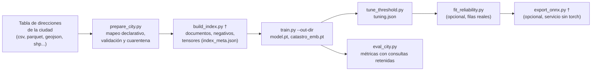

# 11. Entrenar el normalizador para cualquier ciudad

Este documento convierte la lista de verificación de [10-estandar-y-generalizacion.md](10-estandar-y-generalizacion.md) en un flujo ejecutable: un **contrato de datos** para la tabla de direcciones de cualquier ciudad, un **adaptador genérico** con mapeo declarativo de columnas que produce exactamente la entrada de `scripts/build_index.py`†, y una **prueba de extremo a extremo con una ciudad inventada** que demuestra que el flujo corre y aprende. El documento 10 sigue siendo la referencia para la conformidad con el estándar colombiano, las constantes que hay que revisar y el protocolo de validación con datos reales; aquí no se repiten.

Todos los ejemplos (direcciones, códigos prediales, nombres de barrios) son inventados.

> **Código del proyecto de origen, aún no publicado en este espejo.** Los elementos marcados con † en este documento (scripts y módulos como `build_index.py`†, `index_union.py`†, `calibration_report.py`†, `final_evidence.py`†, `retrain_compare.py`†, `jev_check.py`†, `fit_decision.py`†, `index_fallback.py`†, `compare_runs.py`†, `write_retrain_report.py`†, `monitor_signals.py`†, `download_nomenclatura.py`†, `clean_nomenclatura.py`†, `reproject_nomenclatura.py`†, `export_onnx.py`†, y los documentos `docs/onnx.md`† y `docs/retrain_2026-10_*.md`) pertenecen al proyecto de origen y **no están en `normalizador_direcciones/` de este repositorio**; no se pueden ejecutar desde aquí. `decision.py`†, `output_schema.py`†, `onnx_backend.py`† y `tokenizer.py`† solo se publican como copia de servicio en [`normalizador_produccion/src/cali_address/`](../../normalizador_produccion/src/cali_address/), no en `normalizador_direcciones/src/`. Las cifras y los comportamientos descritos se tomaron del proyecto de origen y no se pueden reproducir con solo el contenido de este espejo.

## Contenido

1. [Resumen del flujo](#1-resumen-del-flujo)
2. [Contrato de datos](#2-contrato-de-datos)
3. [Correspondencia con las etapas del pipeline](#3-correspondencia-con-las-etapas-del-pipeline)
4. [La ciudad sintética](#4-la-ciudad-sintética)
5. [Resultados medidos de la prueba de extremo a extremo](#5-resultados-medidos-de-la-prueba-de-extremo-a-extremo)
6. [Volumen mínimo de datos](#6-volumen-mínimo-de-datos)
7. [Tiempo y hardware](#7-tiempo-y-hardware)
8. [Límite honesto: nomenclatura urbana colombiana](#8-límite-honesto-nomenclatura-urbana-colombiana)
9. [Lo que no se verificó](#9-lo-que-no-se-verificó)

## 1. Resumen del flujo



```bash
# 1. adaptador + índice (una sola orden)
python scripts/prepare_city.py --mapping ciudad.json --out-dir runs/ciudad/staging --index-dir runs/ciudad/index
# 2. entrenamiento (en GPU con los valores de producción; en CPU, véase la sección 7)
python scripts/train.py --out-dir runs/ciudad/index
# 3. evaluación con consultas retenidas (sección 5)
python scripts/eval_city.py --index-dir runs/ciudad/index --out runs/ciudad/eval_city.json
# prueba completa con la ciudad inventada, en varios tamaños
python scripts/synthetic_city_e2e.py --work-dir runs/sintetica --sizes 300,1000,3000,10000
```

`runs/` es una carpeta de resultados: no se versiona (la regla de publicación del repositorio la bloquea).

## 2. Contrato de datos

### 2.1 Formatos de entrada

El adaptador lee con los mismos lectores de la CLI de normalización ([docs/any-dataset.md](../docs/any-dataset.md)), así que hereda su detección de codificación, delimitador y encabezado.

| Formato | Extensiones | Coordenadas | Notas |
|---------|-------------|-------------|-------|
| CSV / TSV / texto delimitado | `.csv`, `.tsv`, `.txt` | Columnas `x` / `y` declaradas en el mapeo, con su CRS | Codificación detectada (BOM, UTF-8, cp1252/latin-1, UTF-16); se puede forzar con `encoding` y `delimiter` |
| Parquet | `.parquet` | Columnas `x` / `y` | Tipos nativos |
| GeoJSON | `.geojson`, `.json` con `FeatureCollection` | Geometría de cada entidad (punto o centroide del polígono) | RFC 7946 exige lon/lat (EPSG:4326); si el archivo trae otra proyección, declárela con `crs` |
| Shapefile | `.shp` (con `.shx`, `.dbf`, `.prj`) o `.zip` | Geometría (centroide), reproyectada con el `.prj` | Sin `.prj` el mapeo **debe** declarar `crs` (error en caso contrario) |
| Otros | `.xlsx`, `.xls`, `.jsonl`, `.gpkg`, URL http(s) | Columnas `x` / `y` o geometría (`.gpkg`) | `.xls` y `.gpkg` requieren dependencias opcionales (`xlrd`; `pyogrio`, `geopandas`) |

### 2.2 Campos obligatorios y opcionales

| Rol en el mapeo | Obligatorio | Qué se exige | Columna interna (entrada de `build_index.py`†) |
|-----------------|:-----------:|--------------|-----------------------------------------------|
| `address` | Sí | Texto de la dirección en nomenclatura urbana (una columna, o una lista de columnas que se unen con un espacio) | `nddirecc` |
| `record_id` | Sí | Identificador único y no vacío de cada registro | `source_record_id` (el `gid` interno es el número de fila) |
| `x`, `y` | Sí, salvo entrada con geometría | Coordenadas en el CRS declarado (`x` = longitud o este, `y` = latitud o norte) | `lon`, `lat` (siempre EPSG:4326 a la salida) |
| `parcel_id` | No | Identificador predial: NPN de 30 dígitos o equivalente | `ndnpn` |
| `block` | No | Código de manzana o bloque | `ndmanzana` |
| `district` | No | Comuna, localidad o distrito (nombre o código) | `ndcomuna` (código sintético, ver `city_codes.json`) |
| `neighborhood` | No | Barrio | `ndidbarrio` (código sintético: código del distrito más número de barrio) |
| `status` | No | Estado del registro; exige `status_values` | `ndidestado` (`cert` o `pcer`) |
| `unit` | No | Interior o unidad (`AP 302`, `TO 2`) | `ndinterior` |

Cómo se usan los opcionales:

- `district` y `neighborhood` alimentan las cabezas auxiliares del entrenamiento (`doc_comuna`, `doc_barrio`). Sin ellos, todas las filas comparten una sola clase y esas cabezas no aportan; el entrenamiento funciona igual. Se convierten en códigos porque las etiquetas se leen de códigos; la tabla de correspondencia queda en `city_codes.json`.
- `parcel_id`: el constructor del índice reconoce como NPN completo solo un código de 30 dígitos que empieza por `76001` (Cali). En otra ciudad colombiana el NPN de 30 dígitos sigue la misma estructura nacional y su prefijo de 17 posiciones es la manzana, lo que coincide con el estándar; un identificador no colombiano de 17 o más caracteres también se recorta a 17 para la manzana, y el adaptador lo advierte. Fuera de `76001` el número de predios por dirección (`n_predios`) queda en 1.
- `status` decide qué registros construyen documentos: los valores listados en `status_values.cert` tienen prioridad sobre los de `status_values.pcer` cuando comparten dirección; cualquier otro valor va a cuarentena (`status_not_accepted`). Sin `status`, todos los registros son `cert`.
- `unit`: los registros con interior no crean documentos nuevos; se agrupan bajo su dirección base y aportan consultas oficiales de entrenamiento.

### 2.3 Estándares

| Aspecto | Exigencia | Qué hace el adaptador si no se cumple |
|---------|-----------|---------------------------------------|
| Sistema de referencia | WGS84 lon/lat (EPSG:4326) o un CRS declarado con `crs` (por ejemplo `EPSG:3116` o `EPSG:9377` en Colombia) | Sin `crs` asume EPSG:4326 y lo advierte. Si más de la mitad de las filas cae fuera de lon/lat válidos o fuera del área de uso del CRS declarado, **falla** con una pista (parece proyectado, parece lon/lat, parecen invertidas) |
| Extensión de la ciudad | Opcional: `bbox` en lon/lat y `max_km_from_median` | Filas fuera: cuarentena. Si la mayoría queda fuera del `bbox`, falla como CRS equivocado |
| Codificación | UTF-8 preferida | Se detecta; un archivo que mezcla filas UTF-8 y cp1252 se lee como cp1252 y las celdas con acentos dañados (`ñ`) se reparan; el informe cuenta las celdas reparadas |
| Unicidad | `record_id` único; una fila por registro | Identificador repetido o vacío y fila duplicada exacta (misma dirección, coordenada, predio y unidad): cuarentena |
| Dirección | Nomenclatura urbana con tipo de vía, número, cruce y placa | Vacía o solo símbolos: cuarentena. Una dirección que el analizador no reconstruye queda como documento de respaldo y cuenta en la puerta de `build_index.py`† (tasa de fallas de análisis menor que 1 %) |
| Coordenadas | Numéricas y finitas | Vacías, texto o infinitas: cuarentena; se acepta coma decimal (`3,45`) |
| Volumen de cuarentena | Por defecto, como máximo 5 % de las filas (`max_quarantine_share`) | Por encima: falla (código 2). Se escriben el informe y la cuarentena para revisar, pero no la tabla limpia |

### 2.4 Archivo de mapeo

JSON, TOML (sin dependencias adicionales) o YAML (requiere PyYAML). Las rutas relativas se resuelven contra la carpeta del archivo de mapeo. Ejemplo para la ciudad sintética de la sección 4:

```json
{
  "city": "Ciudad Sintetica",
  "input": "registros.csv",
  "crs": "EPSG:3116",
  "columns": {
    "address": "dir_texto", "record_id": "id_registro", "x": "coord_x", "y": "coord_y",
    "parcel_id": "codigo_predial", "block": "manzana_cod", "neighborhood": "barrio_nombre",
    "district": "distrito_nombre", "status": "estado_registro", "unit": "unidad"
  },
  "status_values": {"cert": ["vigente"], "pcer": ["provisional"]},
  "max_km_from_median": 30
}
```

Claves adicionales: `bbox` (`[lon_min, lat_min, lon_max, lat_max]`), `max_quarantine_share`, y las de lectura `format`, `encoding`, `delimiter`, `sheet`, `header_row`, `layer`. Una clave o un rol desconocido es un error (no se ignora en silencio).

### 2.5 Puertas de calidad y cuarentena

Cada fila rechazada recibe **un** motivo, el primero que aplica en este orden:

| Motivo | Condición |
|--------|-----------|
| `missing_record_id` | Identificador vacío |
| `duplicate_record_id` | Identificador ya visto (se conserva la primera fila) |
| `empty_address` | Dirección vacía o sin letras ni dígitos |
| `missing_coordinates` | `x` o `y` vacía, no numérica o infinita |
| `coordinates_out_of_range` | Fuera de lon/lat válidos o del área de uso del CRS tras la transformación |
| `outside_bbox` | Fuera del `bbox` declarado |
| `far_from_median` | A más de `max_km_from_median` km del centro mediano de la ciudad |
| `status_not_accepted` | Estado no listado en `status_values` |
| `duplicate_row` | Misma dirección, coordenada, predio y unidad que una fila anterior |

Errores de archivo (una sola línea `error:`, nunca una traza): mapeo ausente, mal formado o con claves desconocidas; columna mapeada inexistente (se listan las disponibles); archivo vacío o solo con encabezado; CRS desconocido o incompatible con los valores; shapefile sin `.prj` y sin `crs`; carpeta de salida no vacía sin `--overwrite`.

| Código de salida de `prepare_city.py` | Significado |
|---:|---|
| 0 | Listo (y, con `--index-dir`, índice construido) |
| 1 | Entrada ilegible (archivo inexistente o corrupto) |
| 2 | Error de mapeo o validación, o una puerta falló (cuarentena excesiva; en el índice, las puertas de `build_index.py`†) |
| 3 | Falla inesperada (`--debug` muestra la traza) |
| 130 | Interrumpido |

### 2.6 Salidas del adaptador

| Archivo | Contenido | ¿Publicable? |
|---------|-----------|:------------:|
| `nomenclatura_clean.parquet` | Filas aceptadas en el esquema de entrada de `build_index.py`† | No (datos de la ciudad) |
| `nomenclatura_cleaning_report.json` | Conteos de cuarentena para la contabilidad de `build_index.py`† | Solo agregados |
| `audit_catastro_docs_empty.parquet`, `train_pairs_empty.parquet` | Tablas vacías: una ciudad nueva no tiene índice previo ni pares reales | No aplica |
| `quarantine.parquet` | Cada fila rechazada con su motivo | **No**: contiene filas de entrada |
| `city_codes.json` | Correspondencia nombre a código de distritos y barrios | Según la licencia de los datos |
| `adapter_report.json` | Conteos, motivos, CRS, puertas y advertencias (sin texto de direcciones) | Sí (agregados) |

## 3. Correspondencia con las etapas del pipeline

| Etapa | Script | Entrada | Salida | Qué cambia para otra ciudad |
|-------|--------|---------|--------|-----------------------------|
| Limpieza | `prepare_city.py` (sustituye a `clean_nomenclatura.py`†, que es específico del servicio WFS de Cali) | Tabla de la ciudad y mapeo | `nomenclatura_clean.parquet` y cuarentena | El mapeo |
| Construcción del índice | `build_index.py`† | Salidas del adaptador | `catastro_docs.parquet`, `catastro_own_centroids.parquet`, `spatial_negatives.npy`, `train_data.npz`, `nomenclatura_units.parquet`, `index_meta.json` | Nada en el código; sus puertas (análisis, contabilidad, descartes) se aplican igual |
| Entrenamiento | `train.py --out-dir <índice>` | Carpeta del índice | `model.pt`, `catastro_emb.pt`, `train_report.json`, `experiment.json` | Nada en el código; las cabezas de comuna y barrio toman el número de clases de la ciudad |
| Calibración del umbral | `tune_threshold.py --artifacts-dir <índice>` | Modelo e índice | `tuning.json` | Debe ejecutarse siempre: no copie el umbral de Cali |
| Confiabilidad (opcional) | `fit_reliability.py` | Filas reales con referencia | `reliability.json` | Requiere referencia propia ([10](10-estandar-y-generalizacion.md), sección 4) |
| Exportación ONNX (opcional) | `export_onnx.py --artifacts-dir <índice>`† | `model.pt`, `catastro_emb.pt` | `model.onnx`, `model.int8.onnx`, `catastro_emb.npy` | Nada (resumen del backend ONNX en [14, sección 9](14-reentrenamiento-2026-10.md#9-backend-onnx-y-benchmarks); la guía `docs/onnx.md`† es del proyecto de origen) |
| Evaluación | `eval_city.py`; con datos reales, `eval_strict.py` | Índice entrenado | Métricas agregadas | Ver [12-guia-metricas-y-validacion.md](12-guia-metricas-y-validacion.md) |

## 4. La ciudad sintética

`cali_address.synthetic_city.make_city` genera una ciudad inventada con la **misma nomenclatura** (calles `CL`, carreras `KR`, diagonales `DG` y transversales `TV`, `#` y `-`, letras como `CL 205 A`, `BIS`, cuadrante `SUR`) pero con **otros nombres y números**:

- Cuadrícula regular de calles y carreras cada 100 m. Las calles se numeran desde 200 y las carreras desde 300, por encima de la numeración de Cali (en su índice, el 99.9 % de los números de vía y de cruce son menores que 127), de modo que una dirección generada, con vía y cruce a la vez por encima de 200, no corresponde en la práctica a ninguna dirección real de la ciudad de referencia.
- Barrios y distritos con nombres inventados (por ejemplo, "Villa Cedral", "Distrito Ribera"), un barrio por cada 3 x 3 manzanas y un distrito por cada 3 x 3 barrios.
- Códigos prediales de 30 dígitos con el código de municipio inexistente `99999`; la manzana son sus 17 primeras posiciones.
- Coordenadas en metros de EPSG:3116 con un origen inventado, para ejercitar la reproyección del adaptador.
- Alrededor de 8 % de direcciones con dos unidades interiores (`AP 101`, `AP 201`), 3 % de registros `provisional` y 1 % `anulado` (este último va a cuarentena).
- Nombres de columnas distintos de los internos (`id_registro`, `dir_texto`, `coord_x`...), para que el mapeo sea necesario.

Todas las direcciones generadas se analizan y reconstruyen sin pérdida con el analizador (prueba `test_every_address_round_trips_through_the_parser`).

## 5. Resultados medidos de la prueba de extremo a extremo

Orden ejecutada: `python scripts/synthetic_city_e2e.py --sizes 300,1000,3000,10000 --epochs 3` (semilla 7). Entrenamiento corto en CPU con un codificador reducido (`d_model` 64, 2 capas, 4 cabezas de atención, salida 64, lote 256, unos 0.12 millones de parámetros; el de producción tiene `d_model` 256 y 4 capas y se entrena 8 épocas en GPU). Evaluación con `eval_city.py`: 2 variantes con ruido por documento, para hasta 1 000 documentos muestreados, con una semilla de ruido (20261031) que el entrenamiento nunca usa.

Datos y codificador (r@k = recall@k sobre las consultas retenidas):

| Direcciones pedidas | Registros | En cuarentena | Documentos del índice | Consultas de entrenamiento | Consultas de evaluación | Azar r@1 | Sin entrenar r@1 / r@5 | Entrenado r@1 / r@5 | IC 95 % de la diferencia r@1 (bootstrap pareado) |
|---:|---:|---:|---:|---:|---:|---:|---:|---:|---:|
| 300 | 462 | 2 | 382 | 2 066 | 764 | 0.0026 | 0.014 / 0.055 | 0.596 / 0.842 | [0.546, 0.615] |
| 1 000 | 1 214 | 11 | 1 005 | 5 421 | 2 000 | 0.0010 | 0.001 / 0.010 | 0.914 / 0.958 | [0.901, 0.926] |
| 3 000 | 3 724 | 21 | 3 155 | 16 871 | 2 000 | 0.0003 | 0.000 / 0.001 | 0.934 / 0.979 | [0.922, 0.944] |
| 10 000 | 11 740 | 109 | 9 989 | 53 229 | 2 000 | 0.0001 | 0.000 / 0.000 | 0.939 / 0.980 | [0.927, 0.948] |

Ruta completa (`normalize_batch`: codificador, reordenamiento y umbral 0.73):

| Direcciones pedidas | Ruta completa r@1 / r@5 | Solo reglas r@1 | Cobertura | Precisión de predio de filas emitidas (IC 95 % Wilson) | Precisión de manzana | ECE de `confianza` |
|---:|---:|---:|---:|---:|---:|---:|
| 300 | 0.887 / 0.935 | 0.919 | 0.810 | 1.000 [0.994, 1.000] | 1.000 | 0.097 |
| 1 000 | 0.947 / 0.979 | 0.926 | 0.842 | 1.000 [0.998, 1.000] | 1.000 | 0.060 |
| 3 000 | 0.954 / 0.990 | 0.918 | 0.833 | 1.000 [0.998, 1.000] | 1.000 | 0.047 |
| 10 000 | 0.952 / 0.991 | 0.929 | 0.840 | 1.000 [0.998, 1.000] | 1.000 | 0.049 |

Todas las filas en cuarentena fueron registros `anulado` (`status_not_accepted`), como se diseñó. Con una ciudad de 2 151 documentos se comprobó además que `tune_threshold.py` y `export_onnx.py`† corren sobre el índice nuevo, y que los motores `onnx` y `onnx-int8` dan exactamente las mismas cifras de la ruta completa que `torch` (r@1 0.956, cobertura 0.839).

Lectura honesta:

- **El flujo corre de punta a punta** en todos los tamaños: adaptador, índice (con todas sus puertas superadas y la contabilidad cuadrada), entrenamiento, evaluación.
- **El modelo aprende más allá del azar.** El mismo codificador sin entrenar queda al nivel del azar; entrenado, su recall@1 sube por encima de 0.9 desde mil direcciones, y el intervalo bootstrap pareado de la diferencia entrenado menos sin entrenar está lejos de cero.
- **La ruta solo de reglas es una referencia fuerte con datos sintéticos.** Las variantes sintéticas son en su mayoría errores de formato que el analizador corrige; por eso las reglas solas ya recuperan cerca de 0.92 en el primer puesto. El modelo aporta sobre ellas desde unas mil direcciones y resta en la ciudad más pequeña con pocas épocas (sección 6).
- **La precisión de las filas emitidas sale en 1.0 y la cobertura no cambia con el modelo.** La emisión la deciden las reglas estrictas (la dirección del índice debe tener la misma base que la consulta), y el ruido sintético rara vez fabrica una base plausible pero equivocada. Estas cifras no son una estimación de la precisión con texto real: con direcciones de usuarios aparecen errores que el generador no produce (dirección vieja, barrio en lugar de dirección, placas inexistentes).
- **Es una prueba del flujo, no de calidad de producción**: modelo 30 veces más pequeño que el de producción, pocas épocas, ruido sintético del mismo generador que el entrenamiento y sin referencia independiente.

La prueba automatizada `tests/test_synthetic_city.py::test_end_to_end_training_learns_beyond_chance` repite el flujo con 600 direcciones y 6 épocas (unos 30 s) y exige que el recall@5 del codificador entrenado sea al menos 0.5 y diez veces el azar, que el sin entrenar quede por debajo de 0.1, que el límite inferior del intervalo de la diferencia supere 0.2 y que la precisión de predio de las filas emitidas sea al menos 0.9.

## 6. Volumen mínimo de datos

No hay que suponer un mínimo: se midió. La pregunta tiene dos partes que conviene separar, porque con pocas direcciones también hay pocos pasos de optimización (con lote 256, una ciudad de 382 documentos da 7 pasos por época).

**Volumen frente a pasos de optimización.** Corridas adicionales con el mismo codificador y la misma evaluación, variando las épocas (`synthetic_city_e2e.py --epochs N`; estas corridas compartieron la CPU con otras tareas, por eso no se usan sus tiempos):

| Documentos | Épocas | Pasos de optimización (aprox.) | Entrenado r@1 / r@5 | Ruta completa r@1 | Solo reglas r@1 | r@1 en documentos de validación (consultas) |
|---:|---:|---:|---:|---:|---:|---:|
| 382 | 3 | 21 | 0.596 / 0.842 | 0.887 | 0.919 | 0.50 (30) |
| 382 | 9 | 63 | 0.919 / 0.971 | 0.952 | 0.919 | 0.90 (30) |
| 382 | 30 | 210 | 0.946 / 0.984 | 0.954 | 0.919 | 0.90 (30) |
| 1 005 | 3 | 60 | 0.914 / 0.958 | 0.947 | 0.926 | 0.93 (80) |
| 1 005 | 10 | 200 | 0.948 / 0.986 | 0.962 | 0.926 | 0.96 (80) |
| 9 989 | 1 | 199 | 0.931 / 0.970 | 0.949 | 0.929 | 0.88 (84) |
| 9 989 | 3 | 597 | 0.939 / 0.980 | 0.952 | 0.929 | 0.92 (84) |

Conclusiones medidas (válidas para esta ciudad sintética y este codificador pequeño):

1. **Con pocas direcciones el límite son los pasos, no los datos.** La ciudad de 382 documentos pasa de 0.60 a 0.92 en recall@1 del codificador solo con más épocas, y entonces el modelo ya supera a la ruta solo de reglas (0.952 frente a 0.919).
2. **A igual número de pasos (unos 200), 382, 1 005 y 9 989 documentos llegan a cifras parecidas** (0.93 a 0.95). Más direcciones no empeoran la recuperación aunque el índice sea 26 veces mayor y haya más candidatos confusos.
3. **Regla práctica derivada:** entrene al menos unos 60 pasos de optimización (con lote 256, `épocas >= 60 / (consultas de entrenamiento / 256)`); por debajo de eso el modelo puede restar frente a las reglas. Para una ciudad de unos cientos de direcciones eso significa del orden de 10 épocas; desde unas mil, las 3 épocas de la prueba bastan con este codificador.
4. **Lo que esta medición no dice:** el volumen necesario para que el modelo generalice al texto real de los usuarios ni para calibrar la confiabilidad. Para la referencia real, los tamaños de muestra están en [10](10-estandar-y-generalizacion.md), sección 4.2 (cientos de filas `OK` con referencia por estrato). Las cifras de validación con 30 consultas son muy imprecisas (una consulta equivale a 3 puntos).

## 7. Tiempo y hardware

Equipo de la medición: procesador AMD de 32 hilos lógicos (familia 26), Windows 11, Python 3.14, torch 2.14 solo CPU con 16 hilos de cálculo, sin GPU. Tiempos de pared de la corrida de la sección 5 (3 épocas, codificador de 0.12 millones de parámetros):

| Direcciones pedidas | Adaptador e índice (s) | Entrenamiento, 3 épocas (s) | Segundos por época | Evaluación (s) |
|---:|---:|---:|---:|---:|
| 300 | 3.2 | 12.3 | 4 | 1.4 |
| 1 000 | 1.6 | 36.0 | 12 | 3.4 |
| 3 000 | 4.2 | 103.2 | 34 | 3.2 |
| 10 000 | 11.0 | 290.7 | 97 | 5.1 |

(El 3.2 s del tamaño 300 incluye la primera carga de librerías.) El costo del entrenamiento crece de forma aproximadamente lineal con el número de consultas: unos 19 s por cada 10 000 consultas y época con este codificador pequeño. Para una ciudad del tamaño de Cali (unos 330 000 documentos y del orden de un millón de consultas) eso supondría unos 30 minutos por época **con el codificador pequeño** (extrapolación, no medida). El codificador de producción tiene unos 3.4 millones de parámetros, 27 veces más; en CPU sería mucho más lento (no medido). Recomendación: CPU para pruebas de flujo y ciudades pequeñas; GPU para un entrenamiento de producción (en el equipo de referencia de Cali, unos 16 minutos, según [10](10-estandar-y-generalizacion.md), sección 5). Memoria: ninguna corrida de esta prueba requirió más que la memoria habitual de un portátil; no se midió el pico.

La prueba automatizada de extremo a extremo (600 direcciones, 6 épocas) tarda unos 30 segundos en este equipo.

## 8. Límite honesto: nomenclatura urbana colombiana

El analizador (`parser.py`) y el generador de ruido (`augment.py`) están escritos para la **nomenclatura urbana colombiana en cuadrícula**: tipo de vía (`CL`, `KR`, `DG`, `TV`, `AV`, `AC`, `AK`...), número con letras, `BIS` y cuadrante, `#`, número de la vía que cruza y `-` placa. El adaptador elimina los obstáculos de formato de archivo, columnas, CRS y calidad de filas; **no** cambia la gramática.

### 8.1 Qué se transfiere sin cambios

| Componente | Por qué no depende de la ciudad |
|------------|--------------------------------|
| Adaptador, lectores y cuarentena (`city_adapter.py`, `io/readers.py`) | Genéricos por construcción |
| Constructor del índice (`index_union.py`†, `build_index.py`†) para una ciudad colombiana | Agrupa por clave de dirección canónica, separa grupos dispersos, cuenta cada registro |
| Arquitectura del codificador dual a nivel de carácter, pérdida contrastiva, negativos espaciales, entrenamiento (`model.py`, `train.py`, `dataset.py`) | Aprenden de los documentos de la ciudad; las cabezas auxiliares toman su número de clases de los datos |
| Reordenamiento, abstención y degradación del nivel de precisión (`inference.py`, `service.py`) | Reglas estructurales sobre la dirección analizada |
| Evaluación (`city_eval.py`, `eval_city.py`), exportación ONNX | Independientes del territorio |
| Otra ciudad colombiana con nomenclatura en cuadrícula | Gramática, abreviaturas y NPN nacionales iguales: solo cambian datos, mapeo y las constantes listadas en [10](10-estandar-y-generalizacion.md), sección 3.1 |

### 8.2 Qué hay que adaptar en otro país

| Qué | Dónde | Cambio |
|-----|-------|--------|
| Tipos de vía y abreviaturas | `parser.py`: `VIA_TYPE_CANON` y `_register(...)` | Registrar los tipos del estándar nacional (por ejemplo `RUA`, `AVENUE`, `JIRON`) y sus variantes |
| Estructura de la dirección | `parser.py`: `parse_address`, `canonical`, `_pre_normalize` | La forma `TIPO NÚMERO # CRUCE - PLACA` es colombiana. Con calle y número de puerta (`Calle Mayor 12`) o direcciones con nombre de vía hay que reescribir el analizador y la forma canónica; la clave de documento (`index_union.doc_key`†) depende de ella |
| Cuadrantes, `BIS`, letras | `parser.py`: `QUADRANT_CANON`, `_BIS_WORDS`, reglas de letras | Sustituir por las convenciones locales o desactivarlas |
| Complementos (interiores) | `parser.py`: `COMPLEMENT_CANON`; `complement_lexicon.py` | Léxico local de unidades (`APT`, `PISO`, `DEPTO`) |
| Ruido de entrenamiento | `augment.py`: `VIA_EXPANSIONS`, `QUADRANT_ABBREV`, `CITY_SUFFIXES`, `BARRIO_SUFFIXES`, `COMPLEMENTS` | Variantes de escritura reales del país; con cadenas reales sin etiquetar, `--realistic-noise` recalibra las probabilidades |
| Ruido de ciudad en la entrada | `parser.py`: `CITY_NOISE`; `gazetteer.py`: `NOISE_KEYS` | Nombres del municipio y del departamento o estado |
| Alfabeto del codificador | `tokenizer.py`†: `CHARS` (ASCII en mayúsculas, dígitos y `#-.,/'()|`) | Ampliar para otras escrituras y reentrenar |
| Identificador predial | `index_union.py`†: `_npn_ok` (30 dígitos y prefijo `76001`), cortes `[9:11]`, `[9:13]`, `[:17]`, `[:21]`; `evaluate.predial_lot` | Cortes del identificador local; mientras tanto, mapear distrito, barrio y manzana con columnas propias (el adaptador ya lo permite) |
| Proyección métrica | `geo.py`: `METRIC_CRS = "EPSG:3116"` | CRS proyectado del territorio (afecta distancias, negativos espaciales y el término geográfico) |
| Límites geográficos | `gazetteer.py` y `basemaps/` | GeoJSON propios o `--no-gazetteer` |
| Puerta municipal | `io/pipeline.py`: `_DANE_CALI` y nombres aceptados | Código y nombres del municipio objetivo |
| Mensajes e idioma | `service.py` (`motivo`), API | Traducción si corresponde |

## 9. Lo que no se verificó

- **Ninguna ciudad real distinta de Cali.** Todo lo medido aquí es con la ciudad inventada; no hay evidencia de desempeño con texto real de otra ciudad. Antes de usar resultados de un territorio nuevo aplique el protocolo de [10](10-estandar-y-generalizacion.md), sección 4.
- **El ajuste de la confiabilidad** (`fit_reliability.py`) no se ejecutó: necesita filas reales con referencia.
- **La ruta de producción `normalize_strict`** (CLI y API) con el índice sintético no se evaluó como tal; se evaluó `normalize_batch`. El gazetteer y la puerta municipal siguen siendo los de Cali y deben desactivarse o sustituirse ([10](10-estandar-y-generalizacion.md), sección 3.1, pasos 6 y 8).
- **Otro país.** La sección 8.2 lista los cambios a partir del código; ninguno se implementó ni se probó.
- **GeoPackage, Excel y shapefile reales** se leen con los lectores existentes, cubiertos por sus propias pruebas; las pruebas del adaptador usan CSV, GeoJSON y tablas en memoria.
- **Reproducibilidad.** Los números de las secciones 5 y 6 son de una sola semilla (7); el entrenamiento en CPU no es bit a bit reproducible entre equipos.
