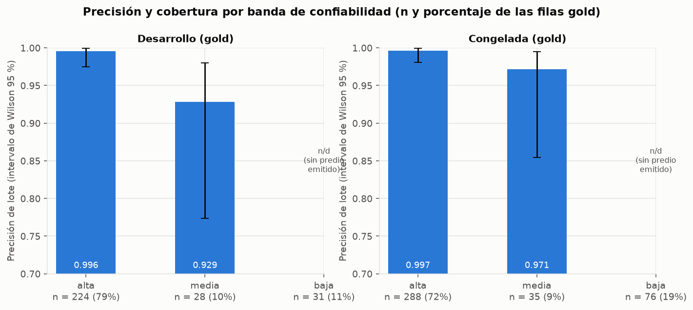
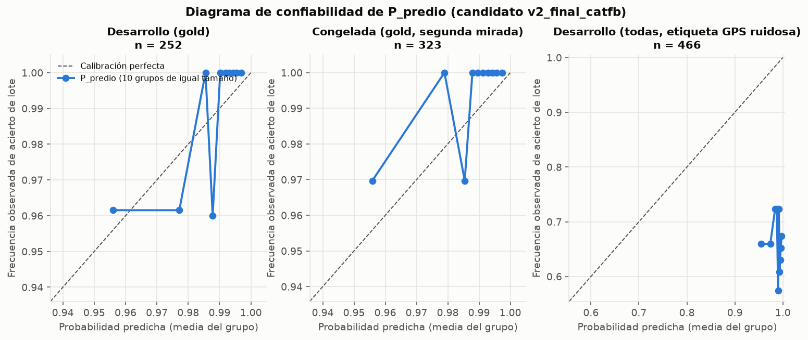
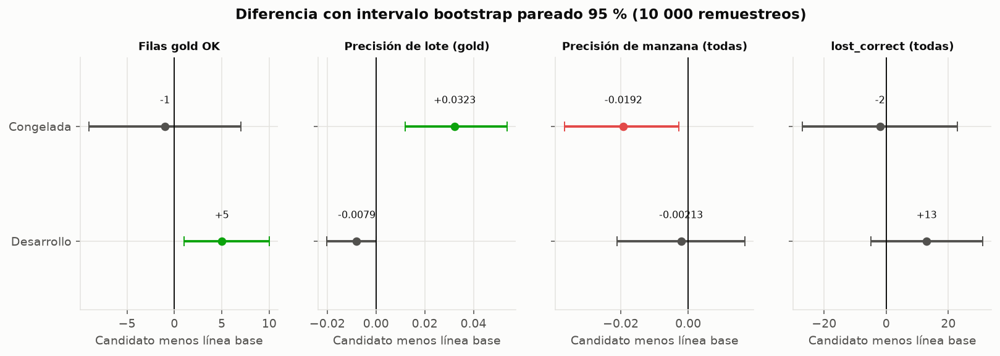
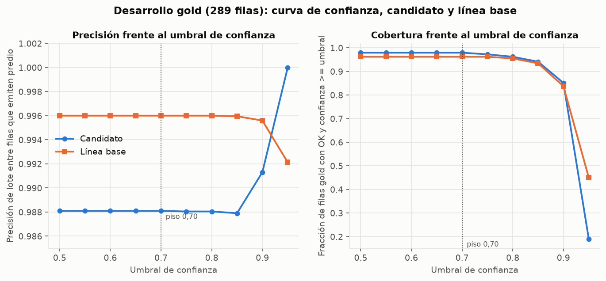
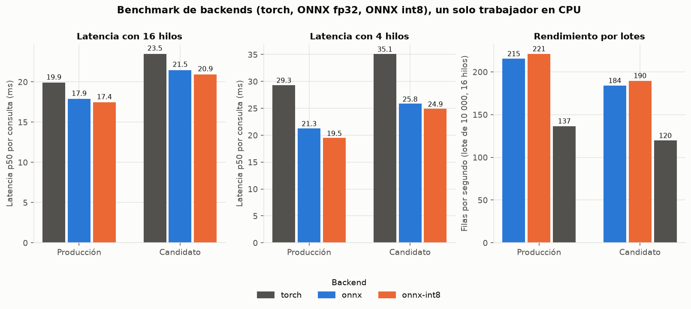
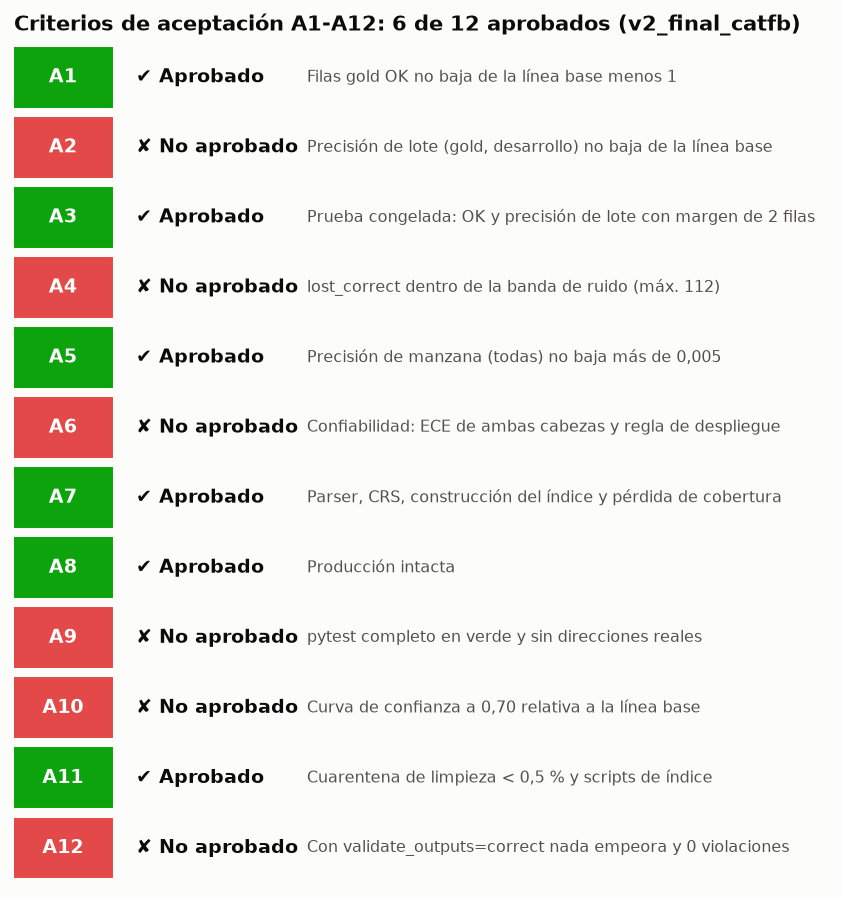

# 13. Mecanismos de validación: qué se mide, cómo se calcula y cómo se lee

> **Alcance.** Este documento explica, con la matemática y la lógica tal como están implementadas, cada mecanismo con el que se valida el normalizador: métricas de acierto, techo del oráculo, cabezas logísticas de confiabilidad, calibración, intervalos de incertidumbre, política de decisión, monitoreo de deriva, validación de salida, auditoría JEV, paridad ONNX y los criterios de aceptación A1 a A12.
>
> **Cifras.** Los ejemplos con números de la forma "sintético" son inventados para enseñar el cálculo y **no son resultados**. Las cifras marcadas "medido" son agregados (conteos y tasas, sin filas ni direcciones) de la corrida `v2_final_catfb` (candidato) frente a `baseline_prod_2026_10` (producción medida con el código actual) y se verificaron contra sus JSON de origen. Donde el JSON no trae la cifra se escribe **n/d**.
>
> **Estado del candidato.** Según `acceptance.json`, el veredicto es **NO APRUEBA** (6 de 12 criterios aprobados: A1, A3, A5, A7, A8, A11). La prueba congelada de esta ronda es una **segunda mirada, no una prueba ciega** (el respaldo catastral se añadió después de ver el resultado congelado de la primera ronda; nada se ajustó con ella, pero no es independiente). Nada de lo aquí escrito autoriza promover artefactos a producción.
>
> Complementa a [08](08-metricas-y-confiabilidad.md) (definiciones y protocolo) y [10](10-estandar-y-generalizacion.md). Fuentes de código: `src/cali_address/evaluate.py`, `calibration_report.py`†, `decision.py`†, `reliability.py`, `final_evidence.py`†, `retrain_compare.py`†, `output_schema.py`†, `jev_check.py`†, `scripts/fit_decision.py`†, `scripts/eval_strict.py`.

> **Código del proyecto de origen, aún no publicado en este espejo.** Los elementos marcados con † en este documento (scripts y módulos como `build_index.py`†, `index_union.py`†, `calibration_report.py`†, `final_evidence.py`†, `retrain_compare.py`†, `jev_check.py`†, `fit_decision.py`†, `index_fallback.py`†, `compare_runs.py`†, `write_retrain_report.py`†, `monitor_signals.py`†, `download_nomenclatura.py`†, `clean_nomenclatura.py`†, `reproject_nomenclatura.py`†, `export_onnx.py`†, y los documentos `docs/onnx.md`† y `docs/retrain_2026-10_*.md`) pertenecen al proyecto de origen y **no están en `normalizador_direcciones/` de este repositorio**; no se pueden ejecutar desde aquí. `decision.py`†, `output_schema.py`†, `onnx_backend.py`† y `tokenizer.py`† solo se publican como copia de servicio en [`normalizador_produccion/src/cali_address/`](../../normalizador_produccion/src/cali_address/), no en `normalizador_direcciones/src/`. Las cifras y los comportamientos descritos se tomaron del proyecto de origen y no se pueden reproducir con solo el contenido de este espejo.

## Contenido

1. [Mapa de mecanismos](#1-mapa-de-mecanismos)
2. [Recall@k (recuperación)](#2-recallk-recuperación)
3. [Acierto de manzana, de lote y de NPN exacto; cobertura; lost_correct](#3-acierto-de-manzana-de-lote-y-de-npn-exacto-cobertura-lost_correct)
4. [Techo del oráculo (compuerta de construcción del índice)](#4-techo-del-oráculo-compuerta-de-construcción-del-índice)
5. [Cabezas logísticas P_predio y P_manzana con restricción de signo](#5-cabezas-logísticas-p_predio-y-p_manzana-con-restricción-de-signo)
6. [Política de decisión: umbrales, piso 0,70 y bandas](#6-política-de-decisión-umbrales-piso-070-y-bandas)
7. [Calibración: ECE, Brier, AUC y diagramas de confiabilidad](#7-calibración-ece-brier-auc-y-diagramas-de-confiabilidad)
8. [Incertidumbre: intervalo de Wilson y bootstrap pareado](#8-incertidumbre-intervalo-de-wilson-y-bootstrap-pareado)
9. [Precisión frente al umbral de confianza](#9-precisión-frente-al-umbral-de-confianza)
10. [Monitoreo de deriva](#10-monitoreo-de-deriva)
11. [Validación de la salida con pydantic](#11-validación-de-la-salida-con-pydantic)
12. [Auditoría JEV: kappa de Cohen y AUC](#12-auditoría-jev-kappa-de-cohen-y-auc)
13. [Paridad y rendimiento del backend ONNX](#13-paridad-y-rendimiento-del-backend-onnx)
14. [Criterios de aceptación A1 a A12 y cómo leer aprobado o no aprobado](#14-criterios-de-aceptación-a1-a12-y-cómo-leer-aprobado-o-no-aprobado)
15. [Reproducir los gráficos y límites de este documento](#15-reproducir-los-gráficos-y-límites-de-este-documento)

## 1. Mapa de mecanismos

| Mecanismo | Pregunta que responde | Dónde vive | Gobierna una decisión en producción |
|---|---|---|---|
| Recall@k | ¿El documento correcto está entre los k candidatos? | `train.recall_at_k` | No (diagnóstico) |
| Precisión de manzana, lote y NPN exacto | ¿Lo que se entregó coincide con la referencia? | `evaluate.py`, `eval_strict.py` | No (evaluación) |
| Techo del oráculo | ¿El índice nuevo alcanza los lotes que el índice viejo alcanzaba? | `index_union.oracle_ceiling_gate`† | Sí, bloquea la construcción del índice |
| Cabezas logísticas | ¿Con qué probabilidad es correcto el lote / la manzana entregados? | `decision.py`† | Sí |
| Umbrales τ_p, τ_m y piso 0,70 | ¿Se emite predio, solo manzana, o se abstiene? | `decision.decide_level` | Sí |
| ECE, Brier, AUC | ¿Las probabilidades están calibradas y discriminan? | `scripts/fit_decision.py`† | Sí, regla de despliegue (A6) |
| Wilson y bootstrap | ¿Cuánta incertidumbre tiene cada cifra? | `calibration_report.py`†, `final_evidence.py`† | No |
| Monitoreo de deriva | ¿Cambió el comportamiento en servicio? | `calibration_report.monitoring_signals`† | Alarma |
| Validación pydantic | ¿La salida respeta el contrato? | `output_schema.py`† | Opcional (`validate_outputs`) |
| JEV | ¿El texto normalizado designa la misma puerta que el original? | `jev_check.py`† | No (auditor externo) |
| A1 a A12 | ¿Puede reemplazar a producción? | `retrain_compare.check_acceptance`† | Sí, veredicto |

Convenciones: *gold* es el subconjunto de filas cuyo texto concuerda con la dirección catastral de la referencia (cota optimista por sesgo de selección); *dev* es desarrollo, *frozen* es la prueba congelada; "lote" es `NPN[:21]`.

## 2. Recall@k (recuperación)

**Definición.** Para $N$ consultas con documento verdadero $d_i$ y los $k$ documentos de mayor similitud coseno $T_k(q_i)$:

$$\text{recall@}k = \frac{1}{N}\sum_{i=1}^{N} \mathbf{1}\left[d_i \in T_k(q_i)\right]$$

La implementación (`train.recall_at_k`) normaliza los embeddings, calcula `sims = emb @ doc_emb.T`, toma `topk(max(k))` y cuenta aciertos para k = 1, 5, 20.

**Para qué sirve.** Es la condición necesaria de todo el sistema: si el documento correcto no está entre los candidatos, ninguna regla ni calibración posterior lo recupera. Se mide sobre consultas con ruido sintético (`syn_recall@k`) y sobre pares reales de validación (`real_val_recall@k`).

**Cómo interpretarlo.** Recall@1 alto significa que el reordenamiento posterior casi no tiene trabajo; la brecha entre recall@1 y recall@20 es el margen que las reglas y el reordenamiento geográfico pueden aprovechar.

**Ejemplo (sintético).** 1 000 consultas; el documento correcto es el primero en 890, está entre los 5 primeros en 960 y entre los 20 primeros en 985. Entonces recall@1 = 0,890, recall@5 = 0,960, recall@20 = 0,985. Las 15 consultas restantes (1,5 %) son irrecuperables para cualquier etapa posterior.

**Valor medido.** n/d: `v2_final_catfb` es una corrida de solo evaluación (`mode: eval-only`) y su fila de tabla de posiciones trae `syn_recall@k` y `real_val_recall@k` en nulo.

**Trampas.**
- Es un diagnóstico, nunca un selector de modelo: los recall sintéticos **no son comparables entre índices distintos**, porque las consultas de validación salen de documentos distintos.
- El recall sintético no dice nada sobre texto real escrito por personas.
- Un recall@k alto no implica precisión: recuperar el vecino correcto entre 20 no es entregarlo.

## 3. Acierto de manzana, de lote y de NPN exacto; cobertura; lost_correct

**Definiciones** (`evaluate.py`). Sea $R$ el conjunto de filas con estado `OK` y referencia disponible (`has_gt`).

- **Precisión de manzana:** $\displaystyle P_{\text{manz}} = \frac{|\{r\in R:\ \text{manzana}(r)=\text{manzana}_{GT}(r)\}|}{|R_{\text{manz}}|}$.
- **Lote:** el *lote* es los primeros 21 caracteres de un NPN de 30 dígitos; los 9 restantes son el sufijo de unidad. `predial_lot(x)` devuelve `x[:21]` solo si `x` es una cadena de solo dígitos con al menos 21 caracteres; en cualquier otro caso (nulo, NaN, corto, con letras) devuelve `None` y **nunca coincide**.
- **Precisión de lote:** $\displaystyle P_{\text{lote}} = \frac{|\{r:\ \text{lote}(npn_r)=\text{lote}(gt_r)\}|}{|R_{\text{lote}}|}$, donde $R_{\text{lote}}$ son las filas `OK` con referencia **que además emiten un predial** (`correct_predial_lot` es NaN si falta la referencia o el predial, igual que `correct_predial`, para que ambas precisiones compartan denominador).
- **Precisión de NPN exacto:** igual, pero comparando la cadena completa de 30 caracteres.
- **Cobertura:** fracción de filas gold con estado `OK` (o `OK` y confianza $\ge t$, ver sección 9): $\text{cobertura}=\dfrac{\#\{\text{OK}\}}{\#\{\text{filas gold}\}}$. El denominador son **todas** las filas, para que un modelo no parezca mejor respondiendo menos.
- **lost_correct:** número de filas **no** `OK` cuyo mejor candidato crudo (antes de reglas, compuerta geográfica y umbral) sí tenía la manzana correcta. Mide el parcelario que el modelo encontró y el sistema descartó.

**Por qué el lote.** La referencia catastral (`gt_predial`) es de nivel de lote, mientras que un NPN de nomenclatura puede llevar otra unidad: en el cruce WFS/shapefile el lote coincide en 98,96 % de los casos y solo el sufijo cambia en cerca de 30 %. Comparar la cadena completa contaría un lote correcto con otra unidad como error. La enmienda del 2026-10-31 movió A2, A3 y A10 a nivel de lote, y la precisión exacta se sigue reportando sin gobernar.

**Cómo interpretarlo.** Siempre con $n$ al lado. Con unas 250 filas emitidas, una fila equivale a unos 0,4 puntos porcentuales.

**Ejemplo (sintético).** Dos NPN de 30 dígitos que difieren solo en la unidad:

```
salida      760010100000000010001 000000001
referencia  760010100000000010001 000000002
```

Los 21 primeros caracteres coinciden: acierto de **lote**, error de **NPN exacto**. Con 100 filas emitidas, 96 con el lote correcto y 12 con el NPN idéntico: $P_{\text{lote}}=0{,}96$ y $P_{\text{exacta}}=0{,}12$. Si el modelo respondió `OK` en 90 de 100 filas gold, la cobertura es 0,90; si de las 10 restantes 3 tenían la manzana correcta en el mejor candidato crudo, `lost_correct` = 3.

**Valores medidos** (dev gold, 289 filas; fuente `extra_metrics.json`, `bootstrap.json`, `confidence_curve_compare.json`):

| Métrica | Candidato | Línea base |
|---|---|---|
| Filas gold `OK` | 283 (cobertura 0,9792) | 278 (0,9619) |
| Precisión de lote (filas que emiten predio) | 0,9881 (n = 252) | 0,9960 (n = 250) |
| Precisión de NPN exacto (gold) | 0,1865 | n/d en esta tabla (la fuente reporta 0,9819 en el documento de aceptación) |
| Precisión de manzana, dev todas (n = 2 078) | 0,8609 | 0,8630 |
| `lost_correct`, dev todas | 121 | 108 |

**Trampas.**
- **La precisión exacta del candidato (0,1865) NO es un error del modelo.** El índice de nomenclatura entrega NPN con unidad y la referencia es de lote; por eso A2 usa lote. Leer 0,1865 como "el 81 % está mal" es un error de lectura.
- La precisión sobre todas las filas de dev (0,6631 de lote) está dominada por el **ruido de la etiqueta GPS** (el punto cae en un vecino), no por el modelo; la cifra gold es la que mide identidad textual.
- Las filas `OK` sin predial (direcciones compartidas) se excluyen del denominador del lote: contarlas como error castigaría una respuesta honesta.

## 4. Techo del oráculo (compuerta de construcción del índice)

**Definición.** Se llama *techo del oráculo* al máximo que puede alcanzar cualquier modelo con un índice dado: si el lote correcto no existe en el índice, ningún recuperador, por perfecto que sea, lo entrega. `index_union.oracle_ceiling`† cuenta, sobre las filas gold de dev y congelada (`total`, aquí 706 filas):

- $m_{\text{prod}}$ = filas cuyo lote existe en el índice de producción;
- $m_{\text{new}}$ = filas cuyo lote existe en el índice nuevo;
- $a$ = filas cuyo lote **no está en la fuente** (costo de cobertura aceptado);
- $n_s = N - a$ = filas con el lote en la fuente (población de construcción).

La compuerta (`oracle_ceiling_gate`, A7 c1 y c2) exige:

$$\text{(c1)}\quad \frac{m_{\text{new}}}{n_s}\ \ge\ \frac{m_{\text{prod},\,s}}{n_s} - 0{,}02 \qquad\qquad \text{(c2)}\quad \frac{m_{\text{prod}}-m_{\text{new}}}{N}\ \le\ \frac{a}{N} + 0{,}01$$

con $m_{\text{prod},s}$ las filas con lote en la fuente que el índice viejo también alcanza.

**Por qué.** Separa dos cosas que se confunden: un **defecto de construcción** (el índice pierde lotes que la fuente sí tiene; c1) y el **costo de cobertura aceptado** de basar el índice solo en fuentes nuevas (lotes que la fuente nunca tuvo; c2).

**Cómo interpretarlo.** c1 pasa si la tasa condicional del índice nuevo no cae más de 2 puntos. c2 pasa si la pérdida titular no excede la pérdida inherente más 1 punto. `lot_lost_incomplete` y `lot_not_chosen` se reportan sin gobernar.

**Ejemplo (sintético).** $N=100$, $a=3$, $n_s=97$, producción alcanza 95 de esas 97, el índice nuevo alcanza 94 (y 0 de las 3 ausentes, aunque producción sí alcanzaba 2 de ellas): $m_{\text{prod}}=97$, $m_{\text{new}}=94$.
c1: $94/97=0{,}969\ \ge\ 95/97-0{,}02=0{,}959$: pasa. c2: $(97-94)/100=0{,}03\ \le\ 0{,}03+0{,}01=0{,}04$: pasa.

**Valores medidos** (`index_meta.json` y `acceptance.json`, A7): $N=706$, $m_{\text{prod}}=699$, $m_{\text{new}}=689$, $a=20$, $n_s=686$, $m_{\text{prod},s}=684$. Cobertura de lote 0,9901 (producción) y 0,9759 (nuevo); c1: $689/686=1{,}0044\ \ge\ 0{,}9771$ (umbral $684/686-0{,}02$); c2: pérdida $10/706=0{,}0142\ \le\ 0{,}0383$ (umbral $20/706+0{,}01$). Faltan 17 lotes en el índice nuevo (`gold_lot_missing_new`), 10 por `lot_not_chosen`, 0 por `lot_lost_incomplete`.

**Trampas.**
- La tasa condicional puede **superar 100 %** (aquí 1,0044): el índice nuevo alcanza 689 lotes con solo 686 en la fuente. Es un hecho observado en `index_meta.json`; la explicación probable es la capa de respaldo catastral (`catfb`), que añade documentos que no vienen de la nomenclatura. No es un error de cálculo.
- Pasar la compuerta de construcción no significa mejor precisión: solo que el índice no pierde lotes que podía tener.
- Si faltan campos del bloque `oracle_ceiling` o no son enteros no negativos, A7 queda **NOT EVALUATED**, nunca "aprobado".

## 5. Cabezas logísticas P_predio y P_manzana con restricción de signo

**Definición.** Dos regresiones logísticas pequeñas (`decision.CalibratedReliability`), una por objetivo:

- $P_{\text{predio}}$: probabilidad de que el **lote** entregado sea la identidad catastral de la dirección escrita;
- $P_{\text{manzana}}$: lo mismo para la manzana, servida como $\max(P_{\text{manzana}},P_{\text{predio}})$ (un lote correcto implica manzana correcta).

Para cada cabeza, con $x_j$ la característica $j$ de 24, $\mu_j,\sigma_j$ su media y desviación guardadas **en esa cabeza**:

$$z_j=\operatorname{clip}\!\left(\frac{x_j-\mu_j}{\sigma_j},\,-5,\,5\right),\qquad \ell=b+\sum_j w_j z_j,\qquad P=\operatorname{clip}\!\big(\sigma(\ell),\,0{,}001,\,0{,}999\big),\quad \sigma(\ell)=\frac{1}{1+e^{-\ell}}$$

Un valor faltante, nulo, NaN, infinito o no numérico se trata como la media ($z=0$, neutro). Si $\sigma_j=0$, $z_j=0$.

**Ajuste** (`scripts/fit_decision.py`†). Pérdida logística con penalización L2, $\lambda = 1/(C\,n)$, minimizada con L-BFGS-B con **cotas por signo**: $w_j\ge 0$ si la característica debe subir la probabilidad (+), $w_j\le 0$ si debe bajarla (−), libre si es 0. `C` se elige de una malla {0,01 … 3} por validación cruzada interna de 3 pliegues agrupada por dirección. Una característica binaria cuyo valor raro tiene menos de 30 filas queda **congelada en 0**. En el candidato quedaron congeladas `relaxed_plate`, `gate_fallback`, `plate_missing`, `cross_missing`, `predial_null` y `nivel_esquina`.

**Por qué.** Sin restricción, una regresión puede aprender un coeficiente con el signo equivocado por ruido (por ejemplo, premiar más competidores) y volverse no monótona. Con la restricción, subir una característica "buena" jamás baja la probabilidad: una propiedad que se verifica con pruebas de monotonía (plan de pruebas de `calib_design/SPEC.md`, sección 11). Además hay un **piso de realidad**: ninguna decisión emitida puede tener $P<0{,}70$.

**Cómo interpretarlo.** Los coeficientes están estandarizados, por lo que su magnitud es comparable. Medido (`reliability_calibrated.json`): cabeza de predio con intercepto 4,265 y $C=0{,}3$; mayores pesos `raw_margin_lot` +0,653, `nivel_via` +0,833, `fidelity_high` −0,872, `soft_n` −0,798, `cat_ambiguous` −0,773, `src_pcer` −0,698, `margen_predio` +0,275, `confidence` apenas +0,072. Cabeza de manzana con intercepto 6,535 y $C=1{,}0$; `nivel_manzana` +1,582, `nivel_via` +1,557, `soft_n` −1,358, `cat_ambiguous` −1,282, `margen_manzana` +0,632. El puntaje bruto `confianza` pesa poco porque, una vez conocidas las señales estructurales, aporta poco en filas gold (por eso se mantiene el piso 0,70).

**Motivos.** La columna `motivos_confiabilidad` lista como máximo 3 razones: $c_j = w_j\,\big(z(x_j)-z(\text{ref}_j)\big)$, descartando $|c_j|<0{,}10$, ordenadas por $|c_j|$ y con prefijo `+` o `-`.

**Ejemplo (sintético).** Cabeza de predio de juguete con intercepto 3,0 y tres características: `confidence` ($w=+0{,}5$, con $z=0{,}4$ en ambas filas), `soft_n` ($w=-0{,}8$, $\mu=0{,}2$, $\sigma=0{,}4$) y `src_pcer` ($w=-0{,}7$, $\mu=0{,}3$, $\sigma=0{,}5$).

- Fila A: `soft_n`=1, `src_pcer`=1: $z_{soft}=2{,}0$, $z_{pcer}=1{,}4$. $\ell=3{,}0+0{,}5(0{,}4)-0{,}8(2{,}0)-0{,}7(1{,}4)=0{,}62$, $P=0{,}650$.
- Fila B: `soft_n`=0, `src_pcer`=0: $z_{soft}=-0{,}5$, $z_{pcer}=-0{,}6$. $\ell=3{,}0+0{,}2+0{,}4+0{,}42=4{,}02$, $P=0{,}982$.
- Motivos de A frente a la referencia 0: `soft_n` aporta $-0{,}8\cdot(2{,}0-(-0{,}5))=-2{,}0$ y `src_pcer` aporta $-0{,}7\cdot(1{,}4-(-0{,}6))=-1{,}4$, luego `-reglas_suaves;-fuente_pcer`.

**Trampas.**
- La probabilidad significa "el código entregado es la identidad catastral de la dirección **tal como se escribió**", no "coincide con un punto GPS". Una compensación de logit ajustada sobre dev completo (cercana a −3,3 en lote) calibraría contra el ruido del GPS y apagaría toda emisión; por eso **no se aplica**.
- Ajustada solo sobre pares gold (`train_pairs`), la cabeza **sobre-predice** en filas ruidosas por construcción: en dev completo la media predicha de P_predio es 0,986 y la frecuencia observada 0,663 (ver sección 7).
- Un archivo de parámetros con características desconocidas, longitudes erróneas o coeficientes no finitos se rechaza y el sistema vuelve al pipeline histórico; no hay degradación silenciosa a medias (`load_calibrated` devuelve `None`).

## 6. Política de decisión: umbrales, piso 0,70 y bandas

**Definición** (`decision.decide_level`). Para una fila que llegó a la decisión, con $e$ = el pipeline emite predial:

$$\text{resultado}=\begin{cases}\text{predio} & e\ \wedge\ P_{\text{predio}}\ge \tau_p\\ \text{manzana} & \text{si no}\ \wedge\ P_{\text{manzana}}\ge \tau_m\\ \text{SIN\_MATCH} & \text{en otro caso}\end{cases}$$

La banda es **alta** si $P_{\text{predio}}\ge 0{,}97$, **media** si $\tau_p\le P_{\text{predio}}<0{,}97$ (ambas con predial) y **baja** cuando solo se entrega manzana. Todas las fronteras son inclusivas; un NaN falla todas las comparaciones y cae en el resultado más seguro. Además toda fila exige `confianza` $\ge 0{,}70$. La capa solo puede **quitar** un predial o una coincidencia, nunca agregar una.

**Validación del archivo** (`validate_decision`): `floor` y `confianza_floor` $\ge 0{,}70$; `floor` $\le \tau_m$; `floor` $\le\tau_p\le$ `bands.alta` $\le 1$; `bands.media` $=\tau_p$; ningún texto del archivo puede leerse como dirección.

**Cómo se eligen los umbrales.** $\tau$ es el menor valor de una malla de paso 0,005 desde el piso cuya precisión acumulada sobre las predicciones fuera de pliegue alcanza el objetivo (0,99 para lote y para manzana). Si ninguno lo alcanza, $\tau$ es el tope de la malla (0,995) y se registra `reached = False`.

**Medido** (`decision.json`): $\tau_p=0{,}94$, $\tau_m=0{,}70$, piso $=0{,}70$, banda alta $\ge 0{,}97$, objetivos 0,99 y 0,99; ajustado con 5 087 filas de lote (4 882 positivas) y 5 014 de manzana, validación cruzada de 5 pliegues agrupada por `address_key`, sobre pares reales gold nunca usados para entrenar.

**Ejemplo (sintético)** de elección de $\tau$ con objetivo 0,95 sobre 10 predicciones fuera de pliegue $P=(0{,}72;\ 0{,}78;\ 0{,}83;\ 0{,}88;\ 0{,}91;\ 0{,}95;\ 0{,}96;\ 0{,}97;\ 0{,}98;\ 0{,}99)$ con aciertos $y=(0,1,0,1,1,1,1,1,1,1)$:

| $\tau$ | filas con $P\ge\tau$ | precisión | cobertura |
|---|---|---|---|
| 0,70 | 10 | 0,800 | 1,0 |
| 0,80 | 8 | 0,875 | 0,8 |
| 0,835 | 7 | 1,000 | 0,7 |

El primer $\tau$ de la malla con precisión $\ge 0{,}95$ es **0,835** (apenas excluye la fila 0,83, que falló). Una fila con $P_{\text{predio}}=0{,}650$ (fila A de la sección 5) y $P_{\text{manzana}}=0{,}88$: no supera $\tau_p=0{,}94$ y sí $\tau_m=0{,}70$, luego se entrega solo la manzana, banda **baja**; una fila con $P_{\text{predio}}=0{,}982$ cae en banda **alta**.

**Medido** (dev gold, 289 filas; `outcome_shares.json`): 252 emiten predio, 31 solo manzana, 6 `SIN_MATCH`, 0 no parseables. Por banda (`bands.json`): alta n = 224, media n = 28, baja n = 31.



| Banda (dev gold) | n | Precisión de lote | IC Wilson 95 % |
|---|---|---|---|
| alta | 224 | 0,9955 (223/224) | [0,9751; 0,9992] |
| media | 28 | 0,9286 (26/28) | [0,7735; 0,9802] |
| baja | 31 | n/d (no emite predio); manzana 28/28 | manzana [0,879; 1,0] |

| Banda (congelada gold, segunda mirada) | n | Precisión de lote | IC Wilson 95 % |
|---|---|---|---|
| alta | 288 | 0,9965 (287/288) | [0,9806; 0,9994] |
| media | 35 | 0,9714 (34/35) | [0,8547; 0,9949] |
| baja | 76 | n/d; manzana 68/70 | manzana [0,902; 0,992] |

**Trampas.**
- La banda **no** es una probabilidad por sí misma: es un rango de $P_{\text{predio}}$ que se verifica con una muestra. La banda media tiene un intervalo muy ancho (28 filas): no concluya que "media" es peor que "alta" ni que es igual.
- Un corte de un calibrador **no** vale para otro: los umbrales viajan con su `decision.json` y la `reliability_version` debe coincidir con la del modelo.
- La cifra de dev completo (alta: 272/407 de lote) es mucho menor por el ruido de etiqueta (ver sección 3); no es degradación de la banda.
- Lo que el calibrador no puede ver (identidad de la vía incierta, cierres de ventana de placa) se fija por política con topes de nivel; no se "aprende".

## 7. Calibración: ECE, Brier, AUC y diagramas de confiabilidad

**Definiciones.** Sea $p_i\in(0,1)$ la probabilidad predicha y $y_i\in\{0,1\}$ el resultado.

- **Brier:** $\displaystyle \text{Brier}=\frac1n\sum_i (p_i-y_i)^2$. Mide calibración **y** discriminación; menor es mejor; el valor de referencia sin información es $\bar y(1-\bar y)$.
- **ECE** (error de calibración esperado, `_ece` con `bins=10`): ordenar por $p$, partir en $B=10$ grupos de **igual tamaño** $S_b$ y promediar la brecha ponderada:

$$\text{ECE}=\sum_{b=1}^{B}\frac{|S_b|}{n}\,\Big|\ \overline{p}_{S_b}-\overline{y}_{S_b}\ \Big|$$

- **AUC:** probabilidad de que una fila acertada reciba mayor $P$ que una fallida, con empates en $\tfrac12$: $\displaystyle \text{AUC}=\frac{1}{n_+n_-}\sum_{i\in+}\sum_{j\in-}\big(\mathbf 1[p_i>p_j]+\tfrac12\mathbf 1[p_i=p_j]\big)$. Es nulo (NaN) si falta una clase.
- **Diagrama de confiabilidad:** gráfico de $\overline{p}_{S_b}$ (eje x) frente a $\overline{y}_{S_b}$ (eje y). La diagonal es calibración perfecta.

**Por qué.** El Brier detecta si las probabilidades sirven para decidir; el ECE dice **dónde** fallan; el AUC dice si **ordenan** bien aunque estén descalibradas. Hacen falta los tres: una probabilidad constante igual a la tasa base tiene ECE 0 y AUC 0,5.

**Cómo interpretarlo.** Puntos sobre la diagonal: calibrado. Por debajo: sobreconfianza (predice más de lo que ocurre). Un ECE de 0,01 significa que, en promedio, la probabilidad se desvía 1 punto de la frecuencia real.

**Ejemplo (sintético)**, 10 filas ordenadas por $p$ y partidas en 2 grupos de 5:

| Grupo | $p$ | $y$ | $\overline p$ | $\overline y$ |
|---|---|---|---|---|
| 1 | 0,55; 0,60; 0,65; 0,70; 0,72 | 0, 1, 0, 1, 1 | 0,644 | 0,600 |
| 2 | 0,90; 0,92; 0,95; 0,97; 0,99 | 1, 1, 1, 0, 1 | 0,946 | 0,800 |

$\text{ECE}=\tfrac12|0{,}644-0{,}600|+\tfrac12|0{,}946-0{,}800|=0{,}095$. Brier $=0{,}2013$. Con 7 aciertos y 3 fallos hay 21 pares, de los que 14 están bien ordenados: AUC $=14/21=0{,}667$.

**Valores medidos** (`fit_report.json`, fuera de pliegue sobre `train_pairs`):

| Cabeza | n | observado | pred. media | ECE (10) | Brier | AUC | Brier sin restricción | AUC sin restricción |
|---|---|---|---|---|---|---|---|---|
| predio | 5 087 | 0,9597 | 0,9599 | 0,00437 | 0,02712 | 0,8951 | 0,02703 | 0,8985 |
| manzana | 5 014 | 0,9880 | 0,9877 | 0,00223 | 0,00403 | 0,9146 | 0,00390 | 0,9176 |

Reglas de despliegue (A6, `ship_rule_vs_refit`): por cabeza, $\text{Brier}\le \text{Brier}_{\text{refit}}+0{,}002$ **y** $\text{AUC}\ge\text{AUC}_{\text{refit}}$ (sin tolerancia en el AUC).



Transferencia a las filas de evaluación (`reliability_diagrams.json`, 10 grupos de igual tamaño, cabeza de predio):

| Población | n | predicha media | observada |
|---|---|---|---|
| dev gold | 252 | 0,9867 | 0,9881 |
| congelada gold (segunda mirada) | 323 | 0,9868 | 0,9938 |
| dev todas (etiqueta GPS ruidosa) | 466 | 0,9861 | 0,6631 |

**Trampas.**
- **El ECE depende de cómo se agrupa** (aquí 10 grupos de igual tamaño; `fit_reliability.py` usa 5 por omisión). Con pocas filas por grupo, la brecha es ruido: en dev gold cada grupo tiene unas 25 filas y un solo fallo mueve el observado 4 puntos.
- **El A6 compara poblaciones distintas.** El umbral de A6 se obtiene del ECE de validación cruzada del refit de la línea base (híbrido isotónico sobre filas de dev: 0,0975 predio y 0,0338 manzana, más 0,01), mientras el candidato se mide sobre `train_pairs`. Aprobar el ECE (0,0044 frente a 0,1075) no demuestra superioridad: las filas y la dificultad difieren.
- **A6 falla en esta corrida por el AUC**, no por el ECE ni por el Brier: la cabeza con restricción de signo tiene AUC 0,8951 frente a 0,8985 sin restricción, y 0,9146 frente a 0,9176 en manzana (diferencias de 0,003). La regla exige $\ge$ sin tolerancia, así que cualquier pérdida mínima de AUC la hace fallar.
- La brecha de la fila "dev todas" (0,986 predicho frente a 0,663 observado) **no** es descalibración del modelo: la etiqueta GPS apunta a vecinos. Calibrar a esa etiqueta apagaría toda emisión.
- Los AUC cercanos a 0,5 de un calibrador **ajustado sobre etiquetas ruidosas** (como el híbrido de línea base: 0,448 y 0,564) indican etiqueta ruidosa, no ausencia de señal.

## 8. Incertidumbre: intervalo de Wilson y bootstrap pareado

### 8.1 Intervalo de Wilson

**Definición** (`calibration_report.wilson_interval`†). Para $k$ aciertos en $n$ pruebas, $\hat p=k/n$ y $z=1{,}96$:

$$\text{IC}=\frac{\hat p+\dfrac{z^2}{2n}\ \pm\ z\sqrt{\dfrac{\hat p(1-\hat p)}{n}+\dfrac{z^2}{4n^2}}}{1+\dfrac{z^2}{n}}$$

Devuelve `(NaN, NaN)` si $n=0$ y lanza `ValueError` si $k<0$, $n<0$ o $k>n$; los extremos se recortan a $[0,1]$.

**Por qué.** El intervalo normal clásico $\hat p\pm z\sqrt{\hat p(1-\hat p)/n}$ degenera en $\hat p=0$ o $1$ (ancho cero) y se sale de $[0,1]$; Wilson no.

**Cómo interpretarlo.** Es el rango de tasas verdaderas compatibles con lo observado. El ancho se contrae como $1/\sqrt n$.

**Ejemplo (sintético).** 9 aciertos en 10: $\hat p=0{,}90$, IC $=[0{,}596;\ 0{,}982]$. Con 90 en 100 (misma tasa): $[0{,}826;\ 0{,}945]$. Con 19 en 20: $[0{,}764;\ 0{,}991]$. Con 0 en 20 el límite superior es $0{,}161$, no 0.

**Medido.** Alta dev gold 223/224: $[0{,}9751;\ 0{,}9992]$ (el 0,9955 puntual, pero hasta 2,5 puntos por debajo es compatible). Media 26/28: $[0{,}7735;\ 0{,}9802]$.

**Trampas.** Es un intervalo **para una tasa binomial independiente**: no incorpora el sesgo del subconjunto gold ni el ruido de la referencia, y supone filas independientes (varias filas de una misma dirección no lo son). Comparar dos intervalos que se solapan no equivale a una prueba de diferencia: para eso se usa el bootstrap pareado.

### 8.2 Bootstrap pareado

**Definición** (`final_evidence.paired_bootstrap`†). Para una métrica $m$ (cociente $\sum a_i/\sum b_i$ o suma), se remuestrean **las mismas posiciones de fila** para candidato y línea base, $B=10\,000$ veces (semilla 20261031), y se calcula

$$\Delta^{(r)}=m_{\text{cand}}\!\left(\text{filas}^{(r)}\right)-m_{\text{base}}\!\left(\text{filas}^{(r)}\right),\qquad r=1,\dots,B$$

El intervalo es el **percentil** 2,5 y 97,5 de $\{\Delta^{(r)}\}$; $p_{\Delta<0}$ es la fracción de remuestreos con $\Delta<0$ (los remuestreos con razón indefinida se descartan). Las filas deben estar alineadas por posición (se verifica `raw_address`).

**Por qué.** Remuestrear filas **conjuntamente** conserva la correlación entre ambos modelos (filas fáciles para uno son fáciles para el otro), así el intervalo de la diferencia es más estrecho y honesto que restar dos intervalos independientes.

**Cómo interpretarlo.** Si el intervalo no contiene 0, la diferencia es distinguible del ruido de muestreo. $p_{\Delta<0}$ cerca de 0,5 significa "ni a favor ni en contra"; cerca de 0 o 1, dirección consistente.

**Ejemplo (sintético).** 5 filas, línea base acierta (1,1,0,1,0), candidato (1,1,1,1,0): diferencia puntual $0{,}8-0{,}6=+0{,}2$. En un remuestreo con las posiciones (3,3,5,1,2) la línea base acierta $0+0+0+1+1=2$ y el candidato $1+1+0+1+1=4$ de 5: $\Delta^{(r)}=0{,}8-0{,}4=+0{,}4$. Repetido 10 000 veces, el percentil 2,5 y el 97,5 dan el intervalo.



**Medido** (`bootstrap.json`, candidato menos línea base):

| Métrica | Split | Línea base | Candidato | Diferencia | IC 95 % | $p_{\Delta<0}$ |
|---|---|---|---|---|---|---|
| Filas gold OK | dev | 278 | 283 | +5 | [+1; +10] | 0,0000 |
| Filas gold OK | congelada | 400 | 399 | −1 | [−9; +7] | 0,5476 |
| Precisión de lote gold | dev | 0,9960 | 0,9881 | −0,0079 | [−0,0202; +0,0001] | 0,901 |
| Precisión de lote gold | congelada | 0,9615 | 0,9938 | +0,0323 | [+0,0121; +0,0537] | 0,0002 |
| Precisión de manzana, todas | dev | 0,8630 | 0,8609 | −0,0021 | [−0,0211; +0,0168] | 0,5841 |
| Precisión de manzana, todas | congelada | 0,7314 | 0,7121 | −0,0192 | [−0,0366; −0,0027] | 0,9885 |
| `lost_correct` | dev | 108 | 121 | +13 | [−5; +31] | 0,0731 |
| `lost_correct` | congelada | 223 | 221 | −2 | [−27; +23] | 0,5428 |

**Trampas.**
- El bootstrap pareado muestra que la diferencia en precisión de lote de dev gold (−0,0079) **roza** el cero (límite superior +0,0001) pero A2 usa la regla puntual $\ge 0{,}996$ y falla; el intervalo es evidencia complementaria y no sustituye la regla.
- La diferencia de manzana en la prueba congelada (−0,0192, IC sin 0) es **estadísticamente distinguible**; no la descarte como "ruido". Su lectura corresponde a la sección 14.
- Es un intervalo de **percentil** sin corrección de sesgo, y la prueba congelada es segunda mirada.
- Con $n$ pequeño y métrica de conteo (filas OK), el remuestreo discreto da intervalos de enteros.

## 9. Precisión frente al umbral de confianza

**Definición.** Para un umbral $t\in\{0{,}50,0{,}55,\dots,0{,}95\}$ sobre las filas gold de dev (`confidence_curve`, A10):

$$\text{cobertura}(t)=\frac{\#\{\text{OK}\wedge \text{confianza}\ge t\}}{N_{\text{gold}}},\qquad \text{precisión}(t)=\frac{\#\{\text{lote correcto}\}}{\#\{\text{OK},\ \text{confianza}\ge t,\ \text{emite predial}\}}$$

(`predial_lot_precision_emitted`, `n_emitting_predial`). La tasa de error de manzana es la fracción de filas `OK` con `confianza` $\ge t$ cuyo `correct_manzana` es falso.

**Por qué.** Permite fijar un punto de operación: cuánta cobertura se sacrifica al exigir más confianza. Compara dos modelos **en la misma curva** (A10).

**Cómo interpretarlo.** Una curva ideal sube de precisión sin perder cobertura hasta el final. Entre 0,50 y 0,70 la curva es plana porque el piso 0,70 del sistema ya filtró lo débil.



**Ejemplo (sintético).** 100 filas gold, 94 `OK`; de ellas 80 con `confianza` $\ge 0{,}9$, de las cuales 70 emiten predial con 69 aciertos. Cobertura(0,9) $=80/100=0{,}80$ (denominador: todas las filas); precisión(0,9) $=69/70=0{,}986$.

**Medido** (dev gold, 289 filas, a $t=0{,}70$; `confidence_curve_compare.json`):

| | Candidato | Línea base | Umbral A10 |
|---|---|---|---|
| (a) cobertura $\text{OK}\wedge\text{conf}\ge 0{,}7$ | 0,9792 | 0,9619 | $\ge 0{,}9519$ |
| (b) precisión de lote entre filas que emiten | 0,9881 (n = 252) | 0,9960 (n = 250) | $\ge 0{,}9910$ |
| (c) error de manzana | 0,00707 | 0,00360 | $\le 0{,}00860$ |

Con $t=0{,}90$ el candidato mantiene cobertura 0,8512 y precisión de lote 0,9913 (n = 230; línea base 0,8374 y 0,9956, n = 227). Con $t=0{,}95$ el candidato queda en cobertura 0,1903 y precisión 1,0 (n = 50), frente a 0,4498 y 0,9921 (n = 127) de la línea base.

**Trampas.**
- La versión antigua de la curva contaba como error las filas `OK` **sin** predial (direcciones compartidas) y su precisión a 0,7 era 0,8885 incluso para la línea base: el umbral absoluto 0,98 era inalcanzable. Por eso A10 es **relativa** y a nivel de lote.
- La precisión a $t$ alto se calcula sobre pocas filas (a 0,95 el candidato solo tiene 55 filas `OK`): la curva es ruidosa en la cola, y la precisión 1,0 del candidato a $t=0{,}95$ (n = 50) **no** es mejora demostrada: viene con una cobertura de 0,19 frente a 0,45.
- Una cobertura que sube porque el modelo responde más puede esconder una precisión que baja: lea las dos curvas juntas.

## 10. Monitoreo de deriva

**Definición** (`calibration_report.monitoring_signals`†, `compare_monitoring`, `scripts/monitor_signals.py`). En servicio calibrado se calculan, sobre agregados:

| Señal | Cálculo |
|---|---|
| Cuantiles de $P_{\text{predio}}$ (p10, p25, p50, p75, p90) | de las filas que llegaron a la decisión |
| Participación por banda | fracción alta / media / baja entre filas `OK` |
| Participación de documentos `nomenclatura_pcer` | $\overline{\mathbf 1[\text{fuente}=\text{pcer}]}$ entre `OK` |
| Tasa de abstención | $\dfrac{\#\text{SIN\_MATCH con motivo "confiabilidad baja"}}{\#\text{OK}+\#\text{esas abstenciones}}$ |
| Margen medio | media de `margen` de las `OK`; nulo = 0,3; recortado a [0, 0,3] |
| Confianza media | media de `confianza` de las `OK` |

Alarmas (comparación con una corrida de referencia; los límites son **estrictos**, una deriva exactamente igual al límite no alarma, con tolerancia de $10^{-9}$):

| Señal | Alarma si |
|---|---|
| p25 de $P_{\text{predio}}$ | baja más de 0,05 |
| participación de banda alta | baja más de 10 puntos |
| participación pcer | se mueve más de 10 puntos (en cualquier dirección) |
| tasa de abstención | $c>1{,}5\,b$ |
| margen medio de OK | baja más de 0,03 |
| confianza media de OK | baja más de 0,02 |

Una señal ausente en cualquiera de las dos corridas **nunca** alarma.

**Por qué.** El calibrador se ajustó con datos de un momento; si cambian la fuente de los textos o el catastro, las probabilidades pueden volverse optimistas sin que se note en pruebas. Estas señales no necesitan referencia: detectan que la **forma** de la salida cambió.

**Cómo interpretarlo.** Una alarma no dice "está mal", dice "ya no se parece a la corrida de referencia": hay que auditar una muestra. Que varias señales se muevan juntas es más informativo que una sola.

**Ejemplo (sintético).** Referencia: p25 $=0{,}95$, alta $=0{,}74$, abstención $=0{,}10$. Corrida nueva: p25 $=0{,}88$, alta $=0{,}70$, abstención $=0{,}16$. p25 bajó $0{,}07>0{,}05$: alarma. Alta bajó 4 puntos $<10$: sin alarma. Abstención $0{,}16>1{,}5\times0{,}10=0{,}15$: alarma.

**Valores de referencia.** Los valores de referencia de dev completo (p10/p25/p50 de $P_{\text{predio}}$ = 0,65/0,95/0,99; bandas 0,74/0,13/0,13; pcer 0,345; abstención 0,097; margen 0,258; confianza 0,916) vienen de `calib_design/SPEC.md` sección 10; **n/d** en los JSON agregados de `v2_final_catfb`, que no incluyen un archivo de señales.

**Trampas.**
- El umbral de abstención es relativo; con una referencia cercana a 0 cualquier aumento minúsculo alarma, y con una referencia 0 la regla $c>1{,}5\cdot 0$ alarma ante cualquier abstención.
- La participación pcer mezcla un cambio de fuente de entrada con un cambio del índice: antes de culpar al modelo, verifique cuál ocurrió.
- Las señales se calculan con el mismo `P_predio` que gobierna la decisión: no detectan que **la referencia misma** (el catastro) haya cambiado.

## 11. Validación de la salida con pydantic

**Definición** (`output_schema.py`†). `validate_and_correct(data, mode)` aplica 15 reglas (`RULES`) a cada fila de salida de `normalize_strict`, con tres modos:

| Modo | Efecto |
|---|---|
| `off` | no mira nada |
| `report` | cuenta violaciones por regla; **no toca** la salida (devuelve el mismo objeto) |
| `correct` | aplica solo correcciones **conservadoras**: nunca vuelve una fila más optimista |

Reglas (orden de aplicación): `whitespace`, `estado_vocab`, `nivel_vocab`, `position_tier_vocab`, `confidence_nan`, `confidence_range`, `npn_format`, `coords_partial`, `coords_out_of_bbox`, `high_risk_text`, `text_source`, `tier_nivel_incoherent`, `ok_without_support`, `fuente_vocab`, `banda_vocab`. El contrato es el modelo `NormalizedRecord`: `estado` $\in$ {OK, SIN_MATCH, NO_PARSEABLE}; campos de probabilidad en $[0,1]$; NPN de **30 dígitos**; coordenadas dentro del recuadro de Cali (lon $-76{,}65$ a $-76{,}40$, lat $3{,}30$ a $3{,}55$); `banda_confiabilidad` $\in$ {alta, media, baja}; el nivel no puede ser más preciso de lo que respalda el código disponible (NPN válido $\Rightarrow$ predio; manzana $\Rightarrow$ manzana; nada $\Rightarrow$ vía).

**Qué corrige `correct`.** Confianza fuera de rango se recorta a $[0,1]$ (NaN o no numérica pasa a nula); espacios sobrantes se quitan; un NPN inválido se anula; coordenadas inválidas se anulan con nota en `motivo`; `nivel_precision` y `position_tier` se **bajan** a lo que respalda el dato; un texto de fila no `OK` con riesgo de fidelidad `high` se elimina. Lo que no se puede arreglar sin optimismo (`estado` o `position_tier` fuera del vocabulario) se reporta y se deja.

**Por qué.** La salida sirve a procesos que usan el NPN y la manzana para decisiones; un error de formato (29 dígitos, coordenadas intercambiadas, confianza 1,3) rompe esos procesos aguas abajo de forma silenciosa. Una fila mala **nunca lanza**: solo la falta de una columna requerida o un modo desconocido lanzan `OutputSchemaError`.

**Cómo interpretarlo.** Un conteo de violaciones en `report` distinto de cero señala un defecto del motor, no del dato. El modo `correct` es una red de contención: el criterio A12 exige que no empeore ninguna métrica y que queden **0 violaciones**.

**Ejemplo (sintético).** Una fila con `estado="OK"`, `numero_predial_nacional` de 29 dígitos, `confianza=1.3`, `nivel_precision="predio"`. En `report`: violaciones `npn_format`, `confidence_range`, `ok_without_support`. En `correct`: el NPN se anula, la confianza pasa a 1.0 y, como ya no hay NPN válido, el nivel baja a `manzana` o `via` según haya manzana; la fila queda **menos** precisa, no más.

**Medido.** A12 (`acceptance.json`): `violations_remaining_dev` $=0$; las métricas con `validate_outputs=correct` son idénticas a las de la corrida sin corrección (283, 0,988095, 121, 0,860853), es decir, la corrección no empeoró nada. A12 aun así figura **no aprobado**, porque hereda los fallos de A2, A4 y A10 y porque faltan las métricas congeladas con corrección (`None`).

**Trampas.**
- Un `NaN` en una columna `float64` de un `DataFrame` no se distingue de `None`; ahí NaN significa nulo. En una fila `dict` o columna de objetos, NaN en una confianza **sí** es violación (`confidence_nan`).
- Las correcciones solo **bajan** la precisión; si un modelo depende de la corrección para cumplir el contrato, el defecto está en el motor.
- La validación es de **forma y coherencia interna**, no de verdad: una fila perfectamente válida puede apuntar al lote equivocado.

## 12. Auditoría JEV: kappa de Cohen y AUC

**Qué es y qué juzga.** JEV es un juez basado en un modelo de lenguaje (TypeSafe) usado **solo como auditor sin conexión**; nunca forma parte del servicio (una llamada externa por fila agregaría latencia, costo y exposición de datos). Para cada par se hace una única pregunta, `misma_ubicacion`: *¿la `direccion_normalizada` designa la misma puerta o predio que la `direccion_original`, ignorando abreviaturas, tildes, mayúsculas y puntuación?* Devuelve $p=P(\text{sí})$.

**Etiquetas.** $\text{certeza}=\max(p,1-p)$. Si $\text{certeza}\ge 0{,}85$ (compuerta *auto*) la etiqueta es `yes` ($p\ge0{,}5$) o `no`; en otro caso es `indeterminate` y **queda fuera** de la concordancia. El umbral de *review* es 0,60.

**Métricas** (`validacion_jev.metrics`). Con la matriz de confusión entre "el modelo dice que coincide" y "JEV dice sí" ($tp,fp,fn,tn$, $n$ total):

- **Concordancia:** $\dfrac{tp+tn}{n}$ con intervalo de Wilson 95 %.
- **Kappa de Cohen:** $\displaystyle \kappa=\frac{p_o-p_e}{1-p_e}$, con $p_o=\dfrac{tp+tn}{n}$ y $p_e=\dfrac{(tp+fp)(tp+fn)+(fn+tn)(fp+tn)}{n^2}$. Es `None` si $n=0$ o si $p_e\approx 1$.
- **AUC:** Mann-Whitney con rangos promedio en empates, entre el puntaje del modelo y la etiqueta de JEV; `None` si falta una clase.
- **Brier:** error cuadrático medio del puntaje del modelo frente al veredicto de JEV.

**Por qué.** Da una **segunda opinión independiente de las reglas**, sin necesidad de referencia GPS, sobre si el texto normalizado conserva la identidad del original (números de vía, cruce y placa, letras, sufijos).

**Cómo interpretarlo.** Concordancia alta con $\kappa$ alto: acuerdo más allá del azar. Concordancia alta con $\kappa$ bajo o cero: casi todo es de una clase y el acuerdo es trivial.

**Ejemplo (sintético).** $tp=40$, $fp=5$, $fn=3$, $tn=2$, $n=50$: $p_o=0{,}84$; $p_e=\big(45\cdot43+5\cdot7\big)/2500=0{,}788$; $\kappa=(0{,}84-0{,}788)/(1-0{,}788)=0{,}245$. Concordancia 84 %, pero acuerdo más allá del azar solo moderado-bajo.

**Medido** (`jev_audit.json`; 300 filas ofrecidas por corrida; origen público/sintético):

| Corrida | Etiquetadas | Concordancia | IC Wilson 95 % | $\kappa$ | AUC | Brier | Indeterminadas |
|---|---|---|---|---|---|---|---|
| sintético, candidato | 192 | 191/192 = 0,9948 | [0,9711; 0,9991] | 0,0 | 0,7833 | 0,0080 | 82 |
| sintético, línea base | 192 | 192/192 = 1,0000 | [0,9804; 1,0] | n/d | n/d | 0,1167 | 86 |
| documentos `catfb`, candidato | 123 | 121/123 = 0,9837 | [0,9426; 0,9955] | 0,0 | 0,6302 | 0,0249 | 87 |

**Trampas.**
- **$\kappa=0{,}0$ con 99,5 % de concordancia no es una contradicción:** en el candidato sintético la confusión es $tp=191$, $fp=1$, $fn=0$, $tn=0$; $p_o=p_e=0{,}9948$, luego $\kappa=0$. Con una sola clase real el kappa no informa; en la línea base (192/192) es indefinido y se escribe n/d, no 0. El AUC tampoco tiene significado con tan pocos negativos.
- **La concordancia no es exactitud.** JEV es un modelo de lenguaje, no una verdad de referencia; toda discrepancia requiere revisión humana antes de concluir quién tiene la razón.
- **Lo que JEV NO puede juzgar:** si el NPN o el lote entregado es el catastralmente correcto, si la manzana es la correcta, si el documento existe en el catastro, ni si las coordenadas son las del predio. Solo compara **dos cadenas de texto**. Un normalizador puede producir un texto equivalente al original y apuntar al lote equivocado; JEV lo aprobaría.
- **Las indeterminadas se excluyen:** entre 82 y 87 de cada 300 filas no entran a la concordancia (y otras 26 a 90 se omiten por entrada inválida), así que la cifra describe una submuestra de las filas más claras.
- **Privacidad:** solo salen de la máquina cadenas de dirección de origen `nomenclatura_public` o `synthetic`; cualquier otro origen (`dev`, `frozen_test`, `train_pairs`, sin origen) se rechaza con `PrivacyError` antes de construir cualquier payload. La clave de API solo la maneja `validacion_jev`. Tope por defecto: 300 filas.

## 13. Paridad y rendimiento del backend ONNX

**Definición.** Servir con ONNX Runtime en lugar de torch solo es aceptable si produce **las mismas respuestas**. `bench_final.json` mide, sobre 2 000 direcciones públicas, la similitud coseno entre el embedding de torch y el de ONNX, la fracción de consultas con el mismo documento top-1 y el desplazamiento máximo de coordenadas:

$$\cos(\mathbf e_{\text{torch}},\mathbf e_{\text{onnx}})=\frac{\mathbf e_{\text{torch}}\cdot\mathbf e_{\text{onnx}}}{\|\mathbf e_{\text{torch}}\|\,\|\mathbf e_{\text{onnx}}\|}$$

**Por qué.** torch CPU ocupa unos 0,93 GB de la imagen (2,33 GB en total); ONNX Runtime unas decenas de MB. La estimación sin torch es 1,45 GB (por confirmar con `docker build`).



**Medido** (`bench_final.json`; 16 hilos salvo indicación; un trabajador en CPU):

| Índice | Backend | p50 (ms) | p95 (ms) | Filas/s (lote 10 000) | Pico RSS (MB) |
|---|---|---|---|---|---|
| producción, 330 387 docs | torch | 19,9 | 22,2 | 137 | 1 568 |
| producción | onnx fp32 | 17,9 | 19,9 | 215 | 1 675 |
| producción | onnx int8 | 17,4 | 19,4 | 221 | 1 779 |
| candidato, 401 860 docs | torch | 23,5 | 25,9 | 120 | 1 827 |
| candidato | onnx fp32 | 21,5 | 23,8 | 184 | 1 962 |
| candidato | onnx int8 | 20,9 | 23,3 | 190 | 2 077 |

Con 4 hilos el p50 del candidato es 35,1 / 25,8 / 24,9 ms (torch / fp32 / int8). Paridad sobre 2 000 direcciones públicas: fp32 con coseno mínimo 0,9999999 y top-1 idéntico en 100 % (producción) y 99,95 % (candidato, 1 diferencia en 2 000); int8 con coseno mínimo 0,9996 (producción) y 0,9995 (candidato), top-1 idéntico 100 %, y desplazamiento máximo de coordenadas de 138,8 m (producción) y 231,8 m (candidato).

**Cómo interpretarlo y trampas.**
- Un coseno de 0,9996 **no** es 1,0: int8 puede cambiar el vecino cuando dos documentos están casi empatados (en las 10 consultas inventadas el top-1 idéntico del candidato int8 fue 0,8); la paridad se revisa por top-1 y por coordenadas, no solo por coseno.
- El desplazamiento de coordenadas del int8 llega a cientos de metros en el peor caso: el int8 es una decisión de despliegue que requiere su propia aceptación.
- La matriz de documentos en fp16 (opción de memoria) tuvo p50 de 181,7 ms, unas 8 veces más lenta que fp32 (21,5 ms) en este equipo: no la use por defecto.
- La máquina del benchmark tenía 16 núcleos físicos; las cifras de latencia no se trasladan a otro equipo ni a carga concurrente (no medida).
- El backend por defecto sigue siendo `torch`; ONNX se activa con `NORMALIZER_BACKEND`.

## 14. Criterios de aceptación A1 a A12 y cómo leer aprobado o no aprobado

**Reglas de lectura** (`retrain_compare.check_acceptance`†, fijadas **antes** de entrenar): las comparaciones son **inclusivas** salvo donde se muestra `<` estricto (igual aprueba, una unidad por debajo falla); un NaN **falla** con motivo; una métrica ausente es **NOT EVALUATED** y bloquea "todo aprobado"; los criterios relativos se miden contra la línea base **medida** con el código actual (`baseline_prod_2026_10`), no contra la cifra histórica almacenada. Cada criterio tiene `parts`: un criterio compuesto aprueba solo si **todas** sus partes aprueban.



| ID | Qué exige | Valor del candidato | Umbral | Resultado |
|---|---|---|---|---|
| A1 | `dev_gold_ok` $\ge$ línea base $-1$ | 283 | $\ge 277$ | Aprobado |
| A2 | precisión de lote gold dev $\ge$ línea base | 0,98810 | $\ge 0{,}996$ | **No aprobado** (−0,0079) |
| A3 | congelada: OK $\ge$ base $-2$ filas; precisión de lote $\ge$ base $-2/\text{OK}_{\text{base}}$ | 399; 0,99381 | $\ge 398$; $\ge 0{,}95654$ | Aprobado |
| A4 | `dev_lost_correct` $\le$ máx(base medida, bandas de ruido s2b: 107, 112) | 121 | $\le 112$ | **No aprobado** |
| A5 | precisión de manzana (todas) $\ge$ base $-0{,}005$ | 0,86085 | $\ge 0{,}85799$ | Aprobado |
| A6 | ECE de ambas cabezas $\le$ base refit $+0{,}01$ **y** regla de despliegue contra el refit | ECE 0,00437 / 0,00223; regla `false` | $\le 0{,}1075$ / $\le 0{,}0438$; `true` | **No aprobado** (regla) |
| A7 | fallo del parser $<1\ \%$; CRS; c1 y c2; `accounting.dropped` $=0$ | 0,00160; sí; 1,0044; 0,0142; 0 | $<0{,}01$; sí; $\ge0{,}9771$; $\le0{,}0383$; 0 | Aprobado |
| A8 | `production_untouched` verdadero en toda corrida | verdadero | verdadero | Aprobado |
| A9 | `pytest` completo en verde y `check_no_real_addresses.py` sale 0 | `pytest_green` falso; salida 0 | verdadero; 0 | **No aprobado** |
| A10 | a `confianza` $\ge0{,}7$: (a) cobertura, (b) precisión de lote de filas que emiten, (c) error de manzana | 0,9792; 0,9881; 0,00707 | $\ge0{,}9519$; $\ge0{,}991$; $\le0{,}00860$ | **No aprobado** (b) |
| A11 | cuarentena $<0{,}5\ \%$; `build_index`† y `download_nomenclatura`† salen 0 | 0,00163; 0; 0 | $<0{,}005$; 0; 0 | Aprobado |
| A12 | con `validate_outputs=correct`, A1-A5 y A10 siguen y nada empeora; 0 violaciones | ver sección 11 | no peor que sin corrección; 0 | **No aprobado** |

**Cómo leer un fallo.**
- **Mire la parte que falla, no solo el ID.** A6 aprueba las dos partes de ECE y falla `ship_rule_vs_refit` por una diferencia de AUC de 0,003; A10 aprueba (a) y (c) y falla (b) por 0,003 sobre 0,991 (0,9881 frente a 0,991, con n = 252 emisiones: 249 aciertos; se necesitaban 250, es decir **una fila** por debajo del piso, y unas **dos filas** por debajo del baseline, ≈251 de 252 según su umbral de 0,996; las **tres** filas son el total de lotes erróneos del candidato, no la diferencia).
- **Distinga defecto de ruido.** `SPEC.md` §6.2 y el bootstrap indican que A1, A4, A5 y A10(a) caen dentro del ruido (una fila gold = 0,35 puntos). A2 y A10(b) no son un problema de la capa de decisión: las tres filas con lote erróneo en dev gold son puertas verificadas de la nomenclatura con $P_{\text{predio}}$ entre 0,96 y 0,99 (el lote de la nomenclatura difiere del catastral); con unas 250 filas emitidas A2 permite a lo sumo **un** lote erróneo.
- **A9** figura falso en `acceptance.json` tal como se registró; su causa concreta no está en ese JSON (n/d), y este documento no la infiere.
- **A12** es derivado: hereda A2, A4 y A10 y no puede evaluar A3 porque faltan las métricas congeladas con corrección.
- **Pasar no es mejorar.** Aprobar A5 (manzana) o A7 no dice nada sobre la precisión de lote; y el "todo aprobado" exige los 12.
- **Congelada = segunda mirada.** A3 y A7 se evalúan con la prueba congelada de la ronda 2, no ciega.
- **Veredicto:** 6 aprobados (A1, A3, A5, A7, A8, A11), 6 no aprobados (A2, A4, A6, A9, A10, A12), 0 no evaluados. La promoción a `artifacts/` es un paso aparte que exige aprobación explícita de los mantenedores.

**Trampas.**
- No edite los criterios después de ver una cifra: se fijaron antes de entrenar y las enmiendas del 2026-10-31 se documentaron antes de cualquier entrenamiento (`docs/retrain_2026-10_acceptance.md`†).
- Un umbral relativo se mueve con la línea base: reporte siempre la línea base medida junto al umbral.
- Con $n$ pequeño, un solo caso cambia el veredicto; el criterio es una **regla de gobierno**, no una prueba estadística.

## 15. Reproducir los gráficos y límites de este documento

Los gráficos se generan solo con agregados (sin filas) desde `artifacts/experiments/v2_final_catfb/*.json` y `onnx_bench_final/bench_final.json`:

```bash
# matplotlib es una dependencia solo de documentación, no del paquete en ejecución
python -m pip install matplotlib
PYTHONPATH=src python scripts/make_doc_charts.py --out-dir documentacion/img
```

El script falla con un mensaje claro (`ChartDataError`, código de salida 1) si falta un JSON, está vacío o malformado; sus funciones de carga se prueban con `tests/test_make_doc_charts.py`. Los JSON de entrada no se publican en este repositorio, por lo que el script solo se puede ejecutar donde existan los artefactos.

Límites:

- Todas las cifras son de la corrida `v2_final_catfb` (candidato con 401 860 documentos) y de `baseline_prod_2026_10`; no se validaron fuera de Cali ni en otras fuentes de texto.
- Las precisiones gold son cotas superiores para filas fáciles; las de dev completo están acotadas por el ruido de la referencia GPS.
- Los pesos, umbrales y calibrador se ajustaron con pares reales de `train_pairs` y los criterios se evaluaron sobre dev: el desarrollo no es independiente, y la prueba congelada de esta ronda es una segunda mirada.
- Estas métricas no sustituyen la verificación humana en decisiones jurídicas, catastrales o tributarias.
